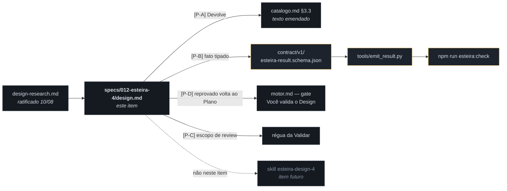
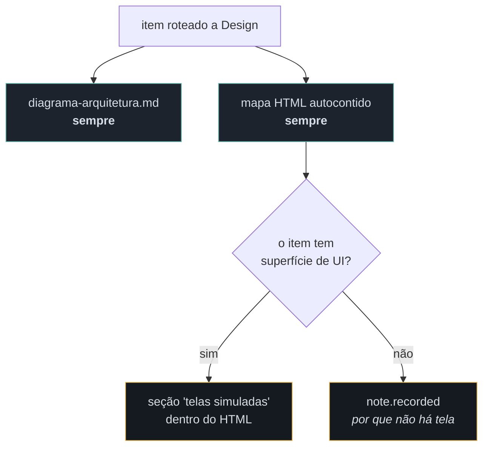
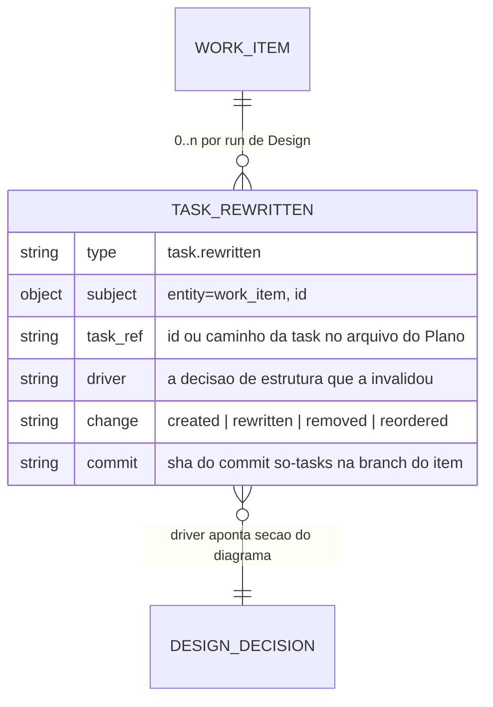
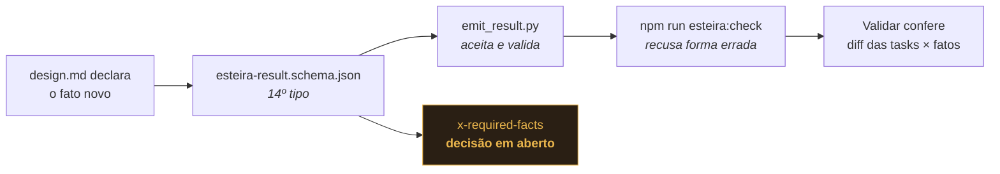
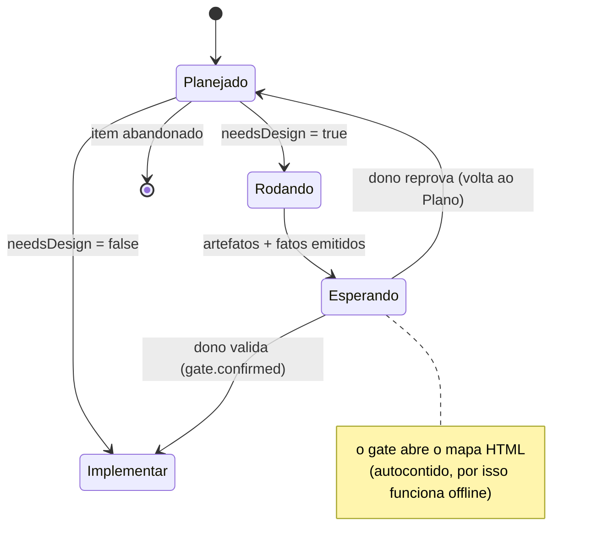

# Diagrama de arquitetura — o miolo da fase Design (`specs/012-esteira-4/design.md`)

> Fase **Design** do item `wi-esteira4-design-spec` · plano
> `pln-esteira4-fase-design` · discovery `dsc-15a7e7f5-fbb` · repo `donel-dev` ·
> 11/08/2026.
>
> **Forma** deste documento vence; **alcance e comportamento** são da spec que a
> fase Implementar deste item vai escrever (`specs/012-esteira-4/design.md`).
> Onde este desenho e a spec divergirem em comportamento, a spec ganha — e a
> divergência vira nota, não silêncio.

Insumos lidos, com caminho:

| Fonte | O que se extraiu |
|---|---|
| `specs/012-esteira-4/design-research.md` (§1–§5 e **§6, ratificação de 10/08**) | O conteúdo que a spec normatiza: os 5 passos da fase, a forma do entregável, a mecânica de reescrita de tasks, o critério de roteamento e as 4 respostas do dono (`[P-A]`…`[P-D]`) |
| `specs/012-esteira-4/catalogo.md` §2 (taxonomia `[F-4]`), §3.3 (o quadro da fase), §3.4, §4 | O texto ratificado que a `[P-A]` **emenda**, e a fronteira "nó do grafo ≠ fase do catálogo" |
| `specs/012-esteira-4/motor.md` (`:108`, `Rodando → Esperando`), `conversa.md` (`:203-204`, roteamento como `decision.recorded`) | Onde o gate encaixa na máquina de estados e quem escreve `needsDesign` |
| `src/shared/esteira/contract/v1/esteira-result.schema.json` | Os **13 tipos de fato** existentes — nenhum cobre reescrita de task; é o buraco que a `[P-B]` manda tapar |
| `.esteira/design/wi-esteira4-{catalogo-fases,motor-spec,conversa-spec}/`, `.esteira/ciclos/dsc-15a7e7f5-fbb/itens/wi-esteira4-layout-esteira-dir/design/` | O molde empírico deste próprio documento: cabeçalho de proveniência → seções numeradas (Mermaid + texto) → tabela toca/não toca → perguntas em aberto |
| `~/.claude/skills/esteira-design-3/SKILL.md` | O processo 3.0 vigente, que a spec 4.0 sucede — reescrever a skill é item futuro, fora deste |

---

## 1. Onde a spec `design.md` encosta no sistema

A spec é texto, mas **quatro dos seus parágrafos têm consequência mecânica** — e é
por isso que este item passou por Design em vez de ir direto a Implementar. O mapa
separa o que é prosa normativa do que obriga código a mudar.

**A fronteira que importa:** só a `[P-B]` atravessa para o lado do código. As outras
três são texto normativo — mas texto que muda um documento **já ratificado**
(`catalogo.md` §3.3), e por isso a spec precisa carregar a emenda por escrito, com o
id da decisão, em vez de reescrever o quadro em silêncio.

---

## 2. O "Devolve" emendado — o par de artefatos vira condicional `[P-A]`

O §3.3 vigente cobra dois `artifact.recorded` **sempre**, com nota para o ausente. A
ratificação troca a régua: o **mapa HTML** e o **diagrama `.md`** passam a ser os dois
obrigatórios, e as **telas simuladas** deixam de ser artefato próprio — viram uma
*seção dentro do HTML*, presente só quando o item tem superfície de UI.

Consequência que a spec precisa escrever com todas as letras: o `artifact_kind`
`"mockup"` **não some** do contrato — ele passa a apontar o **mapa HTML** (que contém
as telas quando há UI), não mais um arquivo de telas separado. Sem isso, a emenda
vira mudança de schema disfarçada de mudança de texto.

| Antes (§3.3 vigente) | Depois (`[P-A]`) |
|---|---|
| `artifact.recorded` mockup **ou** nota | `artifact.recorded` mockup = **o mapa HTML**, sempre |
| `artifact.recorded` architecture-diagram **ou** nota | `artifact.recorded` architecture-diagram = o `.md`, **sempre** |
| a nota justifica artefato ausente | a nota justifica **seção de telas** ausente |

---

## 3. O fato tipado da reescrita de tasks `[P-B]` — a única mudança de contrato

Os 13 fatos do schema não têm nenhum que diga "esta task mudou por causa desta
decisão de estrutura". Hoje isso cabe em `note.recorded` — texto livre, que a Validar
só confere lendo. A ratificação pede tipado, para a conferência ser mecânica.

Os campos acima são **forma proposta**, não nomes fechados — quem fecha nome e
cardinalidade é a spec. O que o desenho fixa é o invariante e a rota da mudança:

**Ponto que a spec não pode deixar implícito:** `design` **não está** hoje na tabela
`x-required-facts` do schema — é por isso que uma fase Design vazia passa no
`esteira:check` (a Iron Law da skill 3.0 é disciplina, não mecânica). Se a `[P-B]`
entra no schema, a pergunta "a Design passa a ser cobrada mecanicamente?" fica na
mesa, e é da spec responder — ver `[P-E]` na seção 6.

---

## 4. O ciclo de vida do item na Design, com a reprovação fechada `[P-D]`

`[P-D]` ratificou: reprovado no gate, o item **volta ao Plano**. Isso fecha o único
laço que faltava — e mantém o "0 ou 1× por item" do §3.3 intacto *por passagem*,
porque é a nova passagem pelo Plano que pode rotear a Design de novo.

A aresta `Esperando → Planejado` é o que este desenho acrescenta ao `motor.md`: hoje a
máquina só conhece a transição de aprovação. A spec precisa dizer **o que sobrevive à
volta** — o diagrama e o HTML da passagem reprovada continuam no ciclo (são registro,
não rascunho descartável), e a passagem nova produz os seus, lado a lado, distinguidos
pelo `run_id`.

---

## 5. O que este item toca / não toca

| Toca | Não toca |
|---|---|
| `specs/012-esteira-4/design.md` (nasce aqui) | a skill `esteira-design-3` instalada — a 4.0 é item futuro, declarado no Plano |
| `specs/012-esteira-4/catalogo.md` §3.3 — **emenda** com o id da ratificação | as outras seções do catálogo, `motor.md` fora do gate, `layout-esteira.md` |
| `src/shared/esteira/contract/v1/esteira-result.schema.json` — 14º fato `[P-B]` | os 13 fatos existentes: nenhum muda de forma |
| `tools/emit_result.py` + `npm run esteira:check` — aceitar e validar o fato novo | o motor em runtime (`src/main`), a UI da Esteira |
| a régua de review da Validar `[P-C]` (texto) | o código da fase Validar |

---

## 6. Perguntas em aberto

- **`[P-E]` A Design entra na `x-required-facts`?** Com o fato novo no schema, a fase
  pode passar a ser cobrada mecanicamente (hoje não é — só disciplina de skill).
  Ampliar a tabela é mudança de contrato com efeito em toda fase Design futura,
  inclusive as que legitimamente não reescrevem task nenhuma. A spec pode propor; quem
  fecha é o dono.
- **`[P-F]` A emenda do §3.3 é edição in-place ou adendo datado?** O catálogo está
  marcado 🟢 DECIDIDA e tem legenda de proveniência por id. Editar o quadro direto é
  mais legível; um adendo preserva o que foi ratificado em 08/08. As duas formas já
  existem no repo — o dono escolhe qual vira padrão.
