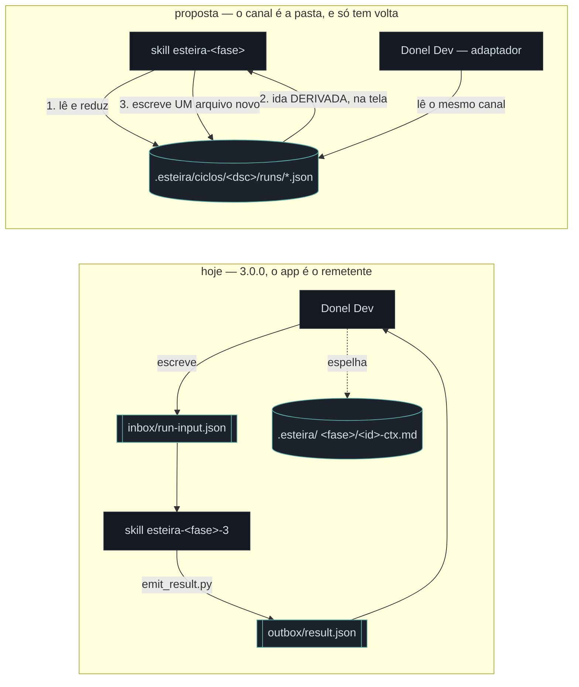
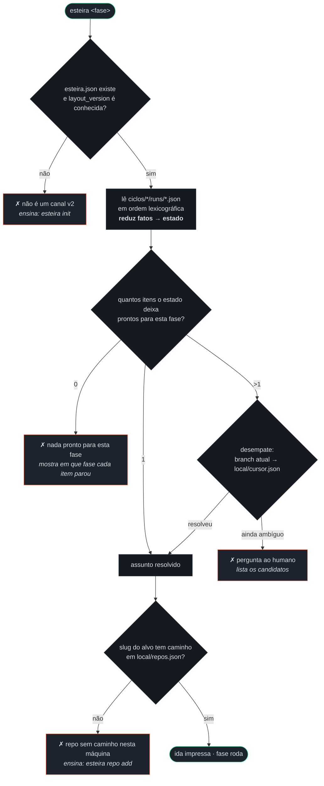
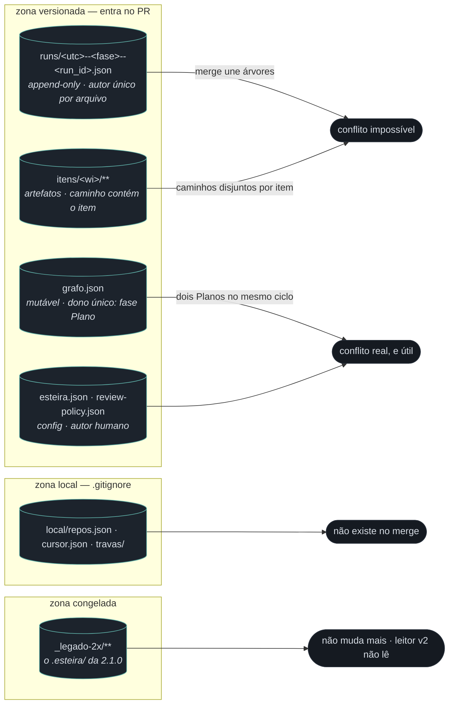
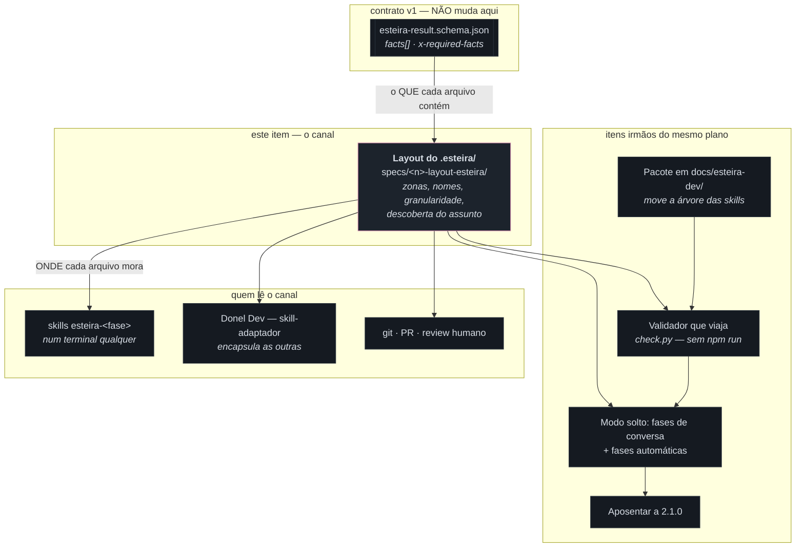

# Diagrama de arquitetura — o `.esteira/` como canal entre fases

> Fase **Design** do item `wi-esteira4-layout-esteira-dir` · plano
> `pln-esteira4-skills-portateis` · discovery `dsc-15a7e7f5-fbb` · repo
> `donel-dev` · 08/08/2026.
>
> **Forma** deste documento vence; **alcance e comportamento** continuam sendo
> da spec que a fase Implementar vai escrever. Onde este desenho e a spec
> divergirem em comportamento, a spec ganha — e a divergência vira nota, não
> silêncio.

Insumos lidos: o `.esteira/` que existe hoje neste repo (`[E]` — `design/`,
`documentar/`, `implementar/`, `plano/`, `validar/` mais `review-policy.json`),
o contrato v1 (`src/shared/esteira/contract/v1/`), o fork de skills 3.0.0
(`tools/read_input.py`, `tools/emit_result.py`) e as decisões do Discovery de
07/08 — em especial **`.esteira/` versionado** e **skills sem o Donel**.

Companheiro deste documento: `mockup-layout-esteira.html`, na mesma pasta — ele
mostra as quatro cenas (árvore, descoberta, erro, diff do PR); este mostra as
fronteiras.

---

## 1. O que muda: a ida deixa de ser escrita e passa a ser derivada

Hoje o canal tem **duas** mensagens e um dono: o app escreve o `run-input.json`
no inbox, a skill devolve o `result.json` no outbox, e o app é quem espelha
qualquer coisa em `.esteira/`. Tirar o app do meio, mantendo o `run-input`,
só transferiria o problema — alguém teria de escrevê-lo.

**A consequência que carrega o resto do desenho:** com a ida derivada, não
existe mais um arquivo que só o app sabe escrever — e é isso, não a instalação
da skill, que a solta do Donel. O app deixa de ser remetente e vira mais um
leitor do mesmo canal.

---

## 2. Como uma fase descobre o assunto lendo só a pasta

Esta é a pergunta que a decisão do disparo abriu, e é o único caminho de
código que o layout **precisa** fixar. O desenho a responde em quatro degraus,
cada um com uma saída explícita quando falha — nenhum deles adivinha.

Três fronteiras saem daqui, e valem para qualquer implementação do leitor:

1. **O estado é derivado, nunca guardado.** Não existe arquivo "estado atual"
   versionado. Se existisse, ele seria mutável e compartilhado — o campo de
   batalha que a seção 3 evita.
2. **O que é da máquina fica na máquina.** Caminho de checkout, cursor e trava
   moram em `local/`, fora do git. O slug do repo é contrato e viaja; o caminho
   não viaja porque não pode.
3. **Ambiguidade vira pergunta, não palpite.** Uma fila que anda sozinha só é
   confiável se souber parar — e "dois itens prontos" é exatamente onde ela
   precisa parar.

---

## 3. Por que a granularidade é contrato: o que o merge faz com cada zona

A pasta é versionada por decisão do Discovery. Isso põe o layout dentro do
`git merge`, e transforma "nome de arquivo" numa decisão com consequência
mecânica — não estética.

| Se o layout fizesse… | O que aconteceria no merge |
|---|---|
| um `index.json` reescrito por toda fase | duas fases em branches diferentes = conflito **em toda leva**, e o resolvedor precisa entender o contrato para arbitrar |
| um `<fase>-result.json` por item (o layout de hoje) | a segunda vez que a mesma fase roda no mesmo item **sobrescreve** a primeira — o histórico do laço fix↔validar desaparece |
| um arquivo por run, com `run_id` no nome | a árvore só cresce; o merge é união; o histórico do laço fica inteiro, e a ordem sai do próprio nome |

A terceira linha é a proposta. As duas primeiras não são hipóteses: a segunda é
o layout instalado hoje (`[E]` — `.esteira/validar/handoffs/<id>/validar-result.json`),
e o laço fix↔validar do catálogo das seis fases roda **até três vezes** no mesmo
item.

---

## 4. Onde este item se encaixa no plano e no sistema

O `.esteira/` é o **canal**; os outros cinco itens do plano são os que passam
por ele. Por isso este item abre a sequência de merge junto do pacote portátil.

### O que este item toca e o que ele não toca

| Componente | Este item… | Por quê |
|---|---|---|
| Contrato v1 (`esteira-result.schema.json`) | **não muda** | o schema diz o que um result **contém**; o layout diz onde ele **mora**. São perguntas diferentes, e misturá-las é o que faria uma mudança de pasta virar mudança de contrato |
| `tools/read_input.py` | **é substituído** por um leitor que deriva | é o único ponto do fork que hoje exige um arquivo que alguém escreveu |
| `tools/emit_result.py` | **muda só o destino** | continua sendo a única porta de saída; passa a escrever em `runs/` com nome determinado pelo layout |
| `src/main/esteira-result-watcher.ts` (`[E]` linha 67) | **muda o caminho** | hoje monta `<stateRoot>/<repo>/<card>/<fase>`; passa a ler o canal versionado |
| `.esteira/review-policy.json` | **não muda** | já mora na raiz e já tem dono humano — a zona de config nasce dele |
| `.esteira/` de hoje (5 pastas de fase) | **é congelado**, não migrado | reescrever handoff antigo no formato novo é inventar fato que ninguém declarou; congelar preserva a leitura humana sem fingir contrato |
| Motor da fila / catálogo das seis fases | **é consumidor** | especificado pelo plano irmão `pln-esteira4-catalogo-e-grafo` |

---

## 5. O que fica em aberto para a spec resolver

Nenhum destes é forma — são todos alcance, e por isso saem daqui como pergunta,
não como desenho:

1. **A pasta é por ciclo ou por plano.** O desenho usa `ciclos/<discovery_id>/`
   porque a raiz de um card é o discovery. Mas um ciclo pode ter vários planos
   (este próprio ciclo tem sete), e o `grafo.json` é **por plano** — ou ele vira
   `planos/<pln>/grafo.json` dentro do ciclo, ou a pasta passa a ser por plano e
   perde a raiz comum.
2. **Sanitização do que é versionado.** O `result.json` de hoje carrega
   `workspace.repo_path` absoluto (`C:/Users/xansd/…`) e `actor.cli_session_id`.
   Versionar caminho de máquina contradiz a fronteira da seção 2 — mas removê-lo
   no arquivo de repo significa que o arquivo versionado **não** é byte-a-byte o
   que a skill emitiu, e o validador precisa saber disso.
3. **Retenção.** `runs/` cresce para sempre por construção. Poda de ciclo
   concluído (mover para `_arquivo/`) mantém o repo leve, mas quebra a promessa
   de que a ordem lexicográfica de `runs/` é o histórico inteiro.
4. **Item cujo alvo é outro repo.** O canal mora no repo âncora, e a fase
   Implementar escreve código no alvo. O run dessa fase cai no `.esteira/` do
   âncora (e não aparece no PR do alvo) ou no do alvo (e o ciclo se parte em
   dois)? A decisão de "âncora e escopo de repo" já existe no app; o layout
   precisa dizer onde o arquivo pousa.
5. **Quem cria o `esteira.json`.** `esteira init` num repo sem canal é um
   comando novo, e comando novo é alcance — este desenho só o nomeia no erro.
