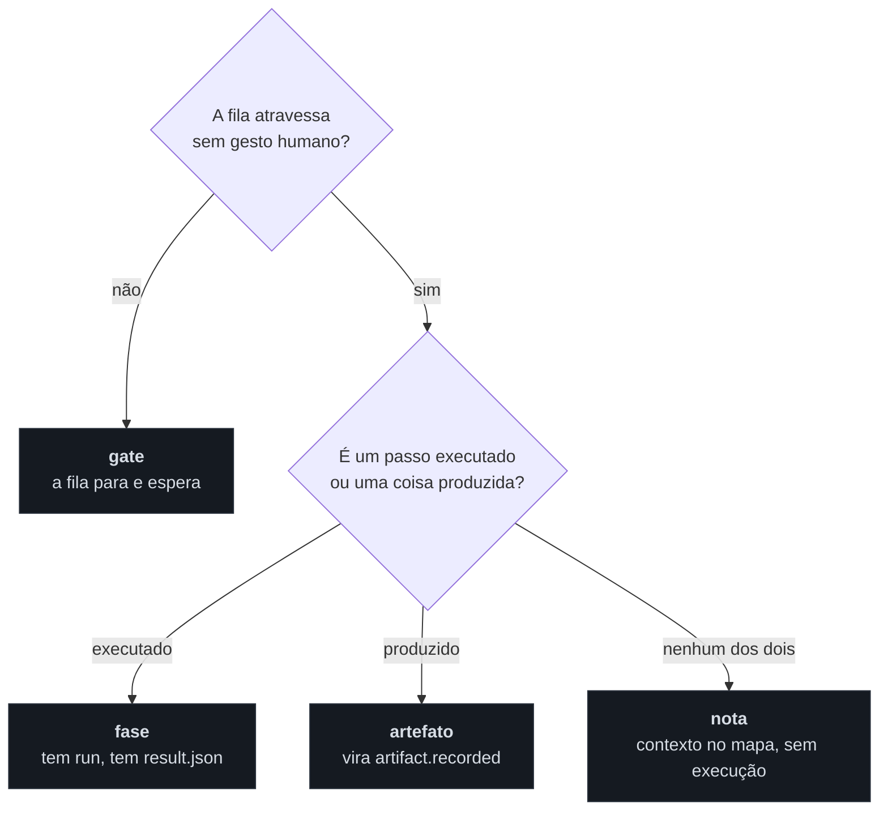
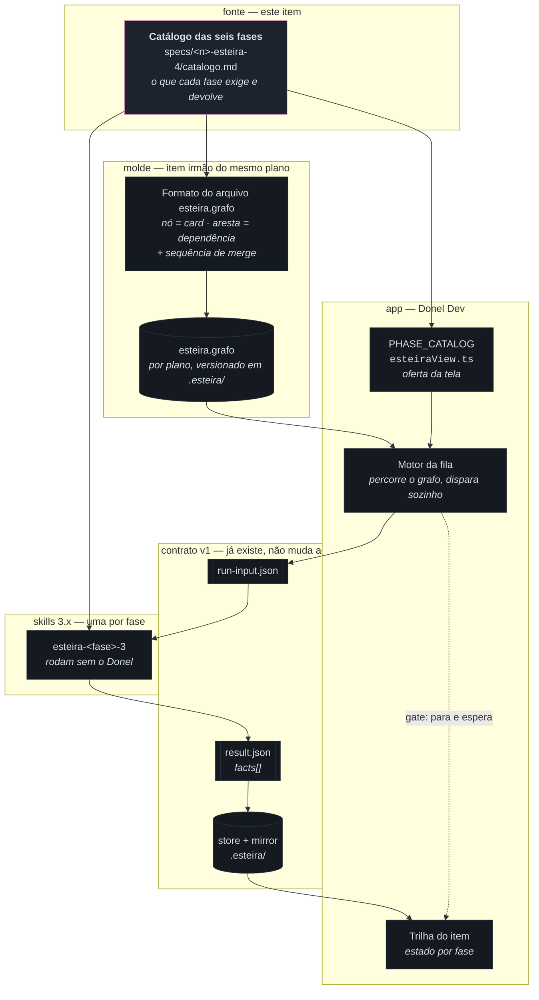

# Diagrama de arquitetura — catálogo das seis fases (esteira 4.0)

> Fase **Design** do item `wi-esteira4-catalogo-fases` · plano
> `pln-esteira4-catalogo-e-grafo` · repo `donel-dev` · 08/08/2026.
>
> **Forma** deste documento vence; **alcance e comportamento** continuam sendo da
> spec que a fase Implementar vai escrever. Onde este desenho e a spec divergirem
> em comportamento, a spec ganha — e a divergência vira nota, não silêncio.

Insumos lidos: `.esteira/plano/pln-esteira4-catalogo-e-grafo/grafo-mesa.json`
(12 nós, 12 arestas — fonte da **forma**), as 11 decisões do Discovery (fonte do
**alcance**) e o `PHASE_CATALOG` que a tela oferece hoje
(`src/renderer/src/Esteira/esteiraView.ts:1301`).

---

## 1. O grafo canônico, reconciliado

O desenho da mesa e as decisões do Discovery não batem em quatro pontos. O
catálogo tem de resolver os quatro — este diagrama mostra **como ficam
resolvidos**, com o que foi acrescentado marcado em nota abaixo.

```mermaid
flowchart LR
  subgraph CICLO["ciclo de um plano"]
    direction LR
    DISC["Discovery<br/><i>gate</i>"]
    PLAN["Plano<br/><i>gate</i>"]
    DES["Design<br/><i>fase</i>"]
    DESOK["Você valida o Design<br/><i>parada humana</i>"]
    IMPL["Implementar<br/><i>fase · 0% humana</i>"]
    PRSTG(["PR para staging<br/><i>artefato</i>"])
    NOMIST["/no-mistakes<br/><i>fase · gate barato</i>"]
    MERGE["Fila de merge<br/><i>fase</i>"]
    SUITE["Suíte + build + e2e<br/><i>fase · 1× por plano</i>"]
    VLOC["Validar — teste local<br/><i>parada humana</i>"]
    FIX["Fix<br/><i>mini Implementar</i>"]
    VSTG["Validar staging<br/><i>fase</i>"]
    CONC["Concluir + Documentar<br/><i>parada humana</i>"]
  end

  DISC --> PLAN
  PLAN -->|"roteia: tem decisão de estrutura"| DES
  PLAN -->|"roteia: não tem"| IMPL
  DES --> DESOK --> IMPL
  IMPL --> PRSTG
  IMPL --> NOMIST --> MERGE --> SUITE --> VLOC
  VLOC -->|"achou defeito"| FIX
  FIX --> VSTG
  VSTG -->|"falhou · rodada < 3"| FIX
  VSTG -->|"passou"| CONC
  VLOC -->|"nada a corrigir"| VSTG
  VSTG -.->|"rodada 3 falhou · fila para"| DESISTE(["Chama o dono<br/><i>teto estourado</i>"])

  classDef gate fill:#1c232c,stroke:#e8b44c,color:#d7dde5
  classDef fase fill:#151a21,stroke:#28303b,color:#d7dde5
  classDef art fill:#1c232c,stroke:#5fb0a8,color:#d7dde5,stroke-dasharray:3 3
  class DISC,PLAN,DESOK,VLOC,CONC gate
  class DES,IMPL,NOMIST,MERGE,SUITE,FIX,VSTG fase
  class PRSTG,DESISTE art
```

### O que foi acrescentado ao desenho da mesa, e por quê

| # | Divergência apontada pelo Plano | Como o desenho resolve |
|---|---|---|
| 1 | O laço `fix ↔ validar` **não é ciclo** na mesa — as arestas iam `val-local → fix → val-stg` e `val-local → val-stg`, sem volta. O teto de 3 rodadas regia um laço que o grafo não desenhava. | Acrescentada a aresta de volta `VSTG → FIX`, rotulada com a condição (`rodada < 3`), e a saída do teto (`rodada 3 falhou → chama o dono`). Sem a volta, o teto não tem o que limitar; sem a saída, a fila não sabe parar. |
| 2 | O `/no-mistakes` decidido entre Implementar e Validar **não tinha nó**; entre `n-impl` e `n-val-local` a mesa punha fila de merge e suíte. | `/no-mistakes` vira nó próprio, **antes** da fila de merge — é o gate barato por card (typecheck + testes dos arquivos tocados), e roda por card, enquanto a suíte roda uma vez por plano. Pôr os dois no mesmo nó apagaria essa diferença de cardinalidade. |
| 3 | O PR para staging aberto pela Implementar (dispensa nomeada) **não aparecia** nem como nó nem como artefato. | Vira **artefato** (nó tracejado) pendurado na Implementar, não fase: ele é o que a fase produz, não um passo que a fila percorre. Fase e artefato serem tipos distintos é o que impede a fila de tentar "executar" um PR. |
| 4 | Discovery e Plano estavam `kind=gate`, não `fase` — precisa casar com a taxonomia que a spec do formato vai fixar. | Mantidos como **gate**, e a taxonomia usada aqui é a da seção 2. Discovery e Plano são gates porque a fila **não os atravessa sozinha**: os dois só terminam com decisão humana ao vivo. É o mesmo critério que faz `Você valida o Design`, `Teste local` e `Concluir` serem gates. |

> **Proposta, não decisão fechada:** as quatro resoluções acima são a forma que
> este Design propõe. Fechar cada uma como texto normativo é o conteúdo que a
> fase Implementar escreve na spec — e é lá que elas viram requisito.

---

## 2. Taxonomia de nó — quatro tipos, um critério cada

A mesa exportou três tipos (`gate`, `fase`, `nota`) e usou artefato só no
vocabulário. O desenho acima precisa de quatro, e cada um tem um critério que
não depende de gosto:

Consequência direta para o motor: **só nó `fase` gera `run-input.json`**. Gate
gera espera, artefato gera fato, nota não gera nada. Um grafo que confunde os
quatro faz a fila tentar disparar sessão para um PR — que é exatamente o tipo de
desencontro de contrato que originou esta spec.

---

## 3. Onde o catálogo se encaixa no sistema

O catálogo é **conteúdo**: ele não é código, é a fonte que três coisas diferentes
leem. O diagrama abaixo mostra quem depende de quem — e é ele que diz por que
esta spec vem antes das outras seis.

### O que este item toca e o que ele não toca

| Componente | Este item… | Por quê |
|---|---|---|
| `PHASE_CATALOG` (`esteiraView.ts:1301`) | **muda** — Documentar sai da lista (dissolve na Concluir), Design ganha condição de roteamento | é a oferta da tela, e a oferta tem de espelhar o catálogo |
| Skills `esteira-*-3` | **muda o conteúdo**, não a instalação | decisão do Discovery: as skills rodam sem o Donel |
| Contrato v1 (`esteira-result.schema.json`) | **não muda** | `run.phase` é string livre (`[P-4]`); nenhum nome novo de fase exige mudança de schema |
| Motor da fila | **é consumidor**, especificado pelo item irmão | o grafo é o molde; o motor percorre |
| `.esteira/` versionado | **ganha** o `esteira.grafo` por plano | decisão do Discovery: `.esteira/` versionado |

---

## 4. O que fica em aberto para a spec resolver

Nenhum destes é forma — são todos alcance, e por isso saem daqui como pergunta,
não como desenho:

1. **Onde mora o roteamento Design|Implementar** — campo do item (`needs_design`)
   ou aresta condicional do grafo. Os dois servem à forma da seção 1; a escolha
   muda o formato do `esteira.grafo`, que é o item irmão.
2. **Quem incrementa o contador de rodadas** do laço fix↔validar — a fase Validar
   ao declarar o fato, ou o motor ao reenfileirar. O teto (3) já está fechado; o
   contador não.
3. **Se `/no-mistakes` é fase com `result.json` próprio** ou passo interno da
   Implementar. O diagrama o desenha como nó porque ele tem cardinalidade
   própria (por card, não por plano) — mas nó no grafo e fase no contrato não são
   a mesma pergunta.
