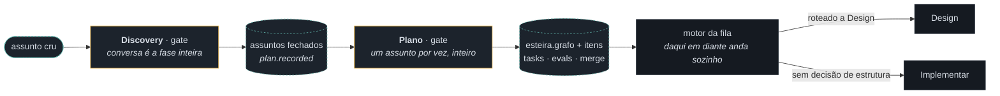
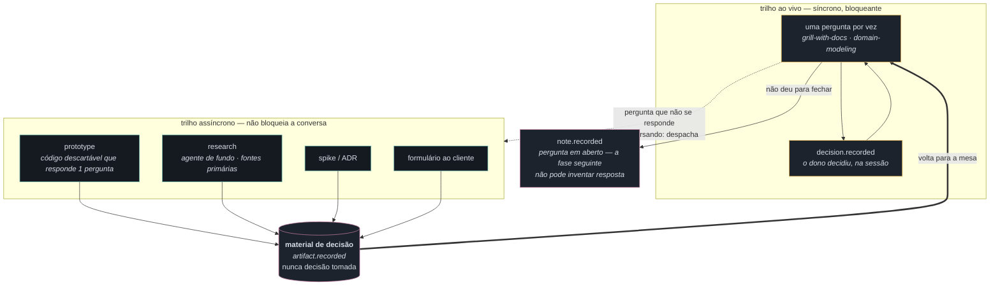
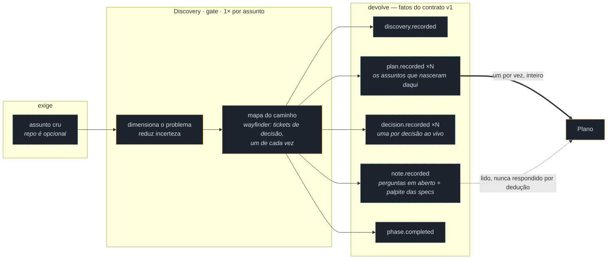
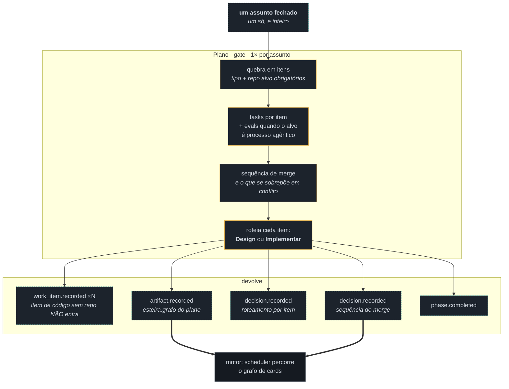
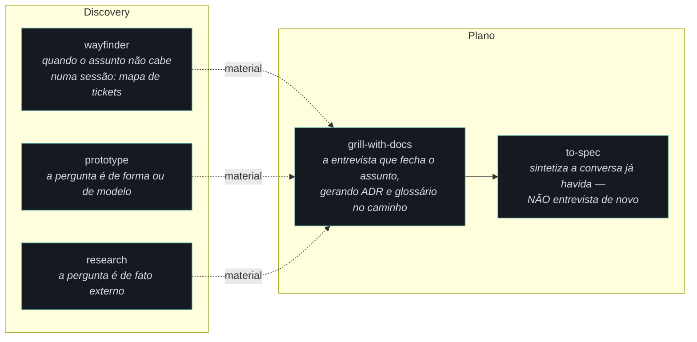

# Diagrama de arquitetura — os gates Discovery e Plano (a conversa com o humano dentro)

> Fase **Design** do item `wi-esteira4-conversa-spec` · plano
> `pln-esteira4-conversa-com-humano` · repo `donel-dev` · 09/08/2026.
>
> **Forma** deste documento vence; **alcance e comportamento** são da spec que a
> fase Implementar deste item vai escrever (`specs/012-esteira-4/conversa.md`).
> Onde este desenho e a spec divergirem em comportamento, a spec ganha — e a
> divergência vira nota, não silêncio.

Insumos lidos: `specs/012-esteira-4/catalogo.md` (§2 taxonomia `[F-4]`, §3.1 e
§3.2 — a forma dos dois gates —, §4 as três paradas humanas), `motor.md` (o
scheduler que consome o que o Plano escreve), a emenda ratificada em 09/08 (o
insumo do Plano é **um assunto fechado**, um só e inteiro — não "uma spec"), e as
cinco skills de referência que o dono nomeou, localizadas em
`C:/Users/xansd/seazone/spotsys/.claude/skills/`: `prototype`, `research`,
`grill-with-docs`, `to-spec` e `wayfinder`.

---

## 1. Onde os dois gates ficam — e por que eles não são "fase com sessão"

Discovery e Plano têm skill, têm `run-input.json` e devolvem `result.json`. Mesmo
assim são **`gate`** pelo critério único da §2: *a fila atravessa sem gesto
humano?* Não — os dois só fecham com decisão tomada ao vivo. A diferença que este
desenho fixa: eles **antecedem** o ciclo do item, então a conversa é a fase
inteira, não uma parada dentro dela (§4).

A fronteira que importa para o motor: **tudo à esquerda de `esteira.grafo` é
conversa; tudo à direita é fila.** O motor não pergunta nada a ninguém porque os
dois gates já perguntaram — e o que eles não perguntaram virou `note.recorded` de
pergunta em aberto, não um palpite embutido no grafo.

---

## 2. A costura central — dois trilhos numa sessão só

O que esta spec existe para separar: o que a fase **pergunta ao vivo** e o que ela
**vai buscar assíncrono**. Os dois correm na mesma sessão; o que muda é quem
decide no fim.

**A aresta grossa é a regra.** O material assíncrono entra na conversa por um
caminho só — de volta à mesa, como insumo de uma pergunta. Não existe aresta de
`prototype`/`research` direto para `decision.recorded`: um protótipo que "decide"
é uma decisão que ninguém tomou, e é exatamente o vício que a Discovery da 4.0
proíbe. O que o material produz é **uma pergunta melhor**, não uma resposta
carimbada.

Consequência de forma (a tela precisa mostrar): uma busca assíncrona em voo
**não** trava a conversa e **não** trava a fila — mas o gate não fecha enquanto
houver material despachado sem volta, ou a decisão que ele ia informar sai sem
ele.

---

## 3. Discovery — o que entra, o que sai, quem consome

O **palpite das specs** sai da Discovery como `note.recorded`, não como
`plan.recorded` extra: é palpite, e palpite que vira registro de plano é palpite
promovido a decisão sem ninguém ter decidido. Quem confirma é o Plano, ao vivo.

Reabrir um assunto é **run novo**, com `complements_run_id` quando é continuação
por orçamento de contexto — nunca edição do run anterior. O log de fatos não é
mutável, e é essa imutabilidade que faz o motor poder re-derivar o mundo.

---

## 4. Plano — um assunto fechado por vez `[emenda 09/08]`

Três invariantes que este desenho põe na fronteira do Plano, e que a spec vai
enunciar como requisito:

1. **Um assunto por run.** Consumir dois assuntos numa sessão é o que produz
   grafo com dependência inventada entre coisas que nunca se falaram. A emenda de
   09/08 troca "uma spec" por "um assunto fechado" justamente porque o insumo nem
   sempre é um documento — mas é sempre **um**, e sempre **inteiro**.
2. **A ordem de merge nasce aqui e só aqui.** A fila não reordena (§3.2). O agente
   que topar com conflito imprevisto decide **pela spec**, registra o conflito e o
   que decidiu — e quem revê é a Validar, não o Plano de novo.
3. **Roteamento é decisão registrada, não inferência do motor** `[P-1]`. O motor
   lê `decision.recorded`; ele não olha o item e adivinha se "parece ter estrutura
   a decidir". Design é 0 ou 1× por item, e **zero é o caso comum**.

---

## 5. Onde as skills entram — e qual delas é ferramenta de qual gate

A divisão não é estética: `to-spec` **declara** que não entrevista, e é por isso
que ela vem depois de `grill-with-docs`, nunca no lugar dele. Rodar `to-spec` num
assunto que ainda não foi grelhado produz uma spec que parece fechada e não é — o
mesmo defeito que a §3.1 chama de "documento inferido".

Nenhuma das cinco está instalada no `donel-dev` hoje. Isto é **alcance**, não
forma: a spec decide se elas são dependência declarada, cópia versionada ou
inspiração — este desenho só fixa **onde** cada uma se encaixa se entrar.

---

## 6. O que este desenho NÃO decide

- **Não** fixa o texto das perguntas de nenhum dos dois gates — isso é a spec.
- **Não** muda o contrato v1: todos os fatos citados já existem. Se a spec
  precisar de um fato novo, isso é mudança de contrato e tem o próprio ciclo.
- **Não** resolve a segunda pergunta em aberto do Discovery (a estrutura da fase
  Design). Ela segue aberta e é de outro item.
- **Não** toca o motor: o motor consome `esteira.grafo` e `decision.recorded` como
  já consome hoje. A fronteira da §1 é a garantia disso.
