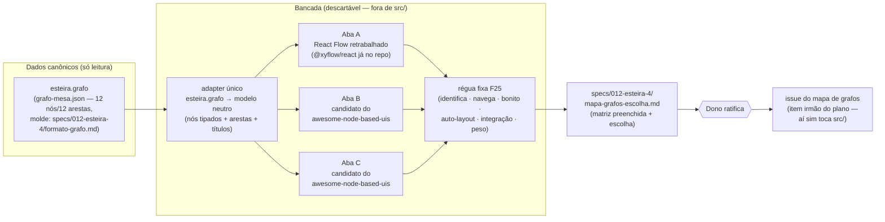

# Diagrama de arquitetura — protótipo do mapa de grafos (bancada + escolha)

> Fase **Design** do item `wi-esteira4-mapa-grafos-prototipo` · plano
> `pln-esteira4-forma-e-leitura` · discovery `dsc-15a7e7f5-fbb` · repo
> `donel-dev` · 12/08/2026.
>
> Este item é um **prototype**: a bancada é descartável, e o que sobrevive
> dela é a ESCOLHA (documento ratificado) mais o adapter de dados. Este
> diagrama fixa as fronteiras — o que a bancada lê, o que ela nunca toca, e
> por onde o resultado desagua na issue do mapa. **Forma** daqui vence em
> Implementar; se a realidade divergir, a divergência vira nota, não silêncio.

## Onde o protótipo se encaixa

## Fronteiras — o que a bancada toca e o que não toca

| Componente | Papel | Toca? |
|---|---|---|
| `grafo-mesa.json` (`.esteira/plano/pln-esteira4-catalogo-e-grafo/`) | dado de entrada, o MESMO nas 2–3 abas | lê, nunca escreve |
| `formato-grafo.md` (🟢 decidida, [G-1]…[G-6]) | molde do dado — o adapter implementa contra ela | lê |
| `src/renderer/src/DevMode/NodeGraphOverlay.tsx` (+ `nodeGraphView.ts`, `nodeGraphLayout.ts`) | a vista ATUAL, reprovada pelo F25 — é a régua do "antes", não base de código da bancada | **não toca** |
| `src/` em geral | app real | **não toca** — bancada mora fora (ex.: `prototypes/mapa-grafos/`, standalone Vite) |
| design-system (`@donel-dev/design-system` tokens) | tema — critério "Integração" mede o custo de cada lib respeitá-lo | lê tokens, não altera |

Duas notas de fronteira que Implementar não deve redescobrir:

1. **A bancada renderiza o `esteira.grafo`, não o `StoreSnapshot`.** A vista
   atual projeta o store (`nodeGraphView.ts`); o mapa novo da 4.0 deriva do
   grafo canônico (`formato-grafo.md`: "a tela deriva a linha Design dele").
   Comparar as libs já no dado certo evita repetir a comparação depois.
2. **Aba A parte do que existe.** `@xyflow/react@12` já é dependência do repo
   e o dono já autorizou motor node-based (cabeçalho de
   `NodeGraphOverlay.tsx:26-32`). A aba A não é "manter como está": é React
   Flow com auto-layout de verdade e custom nodes — o F25 reprovou a vista,
   não necessariamente a lib. Abas B/C vêm da direção que o dono deu
   (github.com/xyflow/awesome-node-based-uis); a seleção dos 2 candidatos é
   decisão de Implementar, registrada na seção 0 do documento de escolha.

## Por onde o dado passa

`grafo-mesa.json` → adapter (validação leve contra o molde + tipagem dos nós
`fase`/`gate`/`artefato`/`nota`) → cada aba recebe o modelo neutro e só faz
RENDER (layout, tema, interação). Anotações do dono por aba ficam na própria
bancada (localStorage basta — é descartável) até serem transcritas para a
matriz do documento de escolha.

## O que depende do quê

- A **bancada** depende só do export da mesa e do molde — nada do motor
  headless, nada da rodada 012 em andamento.
- A **issue do mapa** (quem toca `src/`) depende da escolha ratificada — este
  item é o desaguadouro dela, como o Plano declarou.
- Nenhuma dependência reversa: o app não sabe que a bancada existe.
