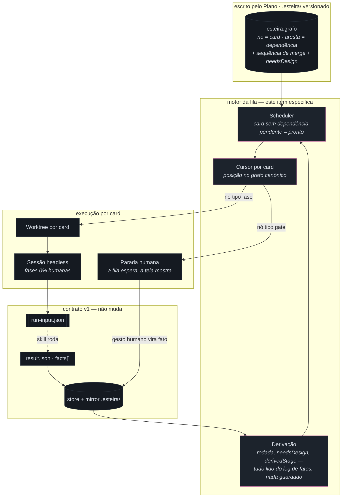
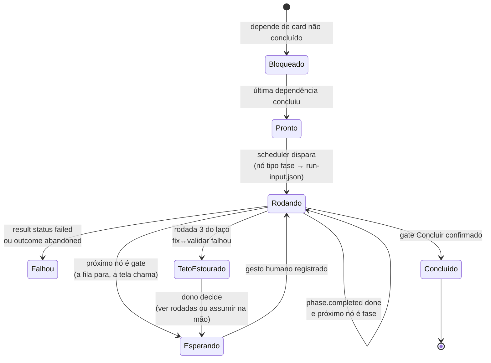
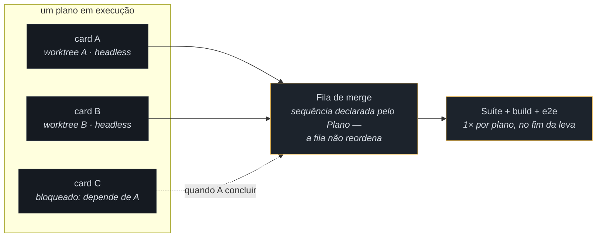

# Diagrama de arquitetura — motor de execução: fila, paralelismo e headless

> Fase **Design** do item `wi-esteira4-motor-spec` · plano
> `pln-esteira4-motor-de-execucao` · repo `donel-dev` · 09/08/2026.
>
> **Forma** deste documento vence; **alcance e comportamento** são da spec que a
> fase Implementar deste item vai escrever (a máquina de estados da fila). Onde
> este desenho e a spec divergirem em comportamento, a spec ganha — e a
> divergência vira nota, não silêncio.

Insumos lidos: `specs/012-esteira-4/catalogo.md` (fonte do alcance — grafo
canônico da seção 1, taxonomia da seção 2, laço com teto 3 da seção 5, e as três
ratificações `[P-1]`…`[P-3]` de 08/08), o grafo da mesa
(`.esteira/plano/pln-esteira4-catalogo-e-grafo/grafo-mesa.json`) e o achado
técnico do auto-start registrado no Discovery (write único `comando + \r` tratado
como paste pelo REPL — hipótese forte, não verificada).

---

## 1. Os dois grafos, e qual deles o motor percorre

A confusão que este desenho existe para impedir: **grafo canônico** (nó = fase,
fixo, vive em código — catálogo seção 1) ≠ **grafo de execução** (nó = card,
aresta = dependência entre cards, varia por plano — o `esteira.grafo` que o
Plano escreve). O motor percorre **os dois, em níveis diferentes**: o de cards
diz *qual card pode andar*; o canônico diz *qual o próximo passo daquele card*.

O laço de realimentação é o coração do desenho: o motor **não tem estado
próprio** — ele dispara, a skill devolve fatos, o store os guarda, e o scheduler
re-deriva o mundo a partir do log. Reinício do app, disparo manual no meio, run
complementado: nada disso soma nem perde estado, porque não há estado a somar.
É a decisão `[P-2]` do catálogo aplicada ao motor inteiro, não só ao contador.

---

## 2. A máquina de estados de um card

O que a spec vai fixar é isto — cada card da fila está em exatamente um destes
estados, e toda transição é causada por um **fato** no log ou por um **gesto
humano** (que também vira fato):

Regras que o desenho assume do catálogo, sem redecidir:

- **Só nó tipo `fase` gera `run-input.json`** (seção 2 do catálogo). Gate gera
  espera; artefato gera fato; nota, nada. O estado `Esperando` é o gate — não
  existe "disparar um gate".
- **A rodada não é campo, é contagem**: número de runs da Validar do item cuja
  verificação ficou `failed` (`[P-2]`). O estado `TetoEstourado` é derivado —
  `rodada == 3 && falhou` — nunca gravado.
- **`/no-mistakes` é condição de aresta**, não estado: a transição
  `Implementar → fila de merge` só acontece com o `check` declarado no
  `result.json` da Implementar (`[P-3]`).

---

## 3. Paralelismo: o que corre junto e o que serializa

- **Paraleliza**: cards sem dependência entre si, cada um na própria worktree,
  cada fase 0% humana em sessão headless própria.
- **Serializa**: a fila de merge (ordem do Plano, sempre) e a suíte completa
  (uma vez, depois do último merge da leva — cardinalidade por plano, não por
  card). Conflito imprevisto no merge: o agente decide **pela spec**, registra
  conflito e decisão como fato; quem revê é a Validar. A fila nunca reordena
  para "desviar" de um conflito.

---

## 4. Headless e o conserto do Enter — fronteira entre dois itens

O motor **depende** de a sessão headless receber o próprio Enter — e hoje ela
não recebe. O achado do Discovery (hipótese forte, não verificada): o
`armEsteiraAutoStart` escreve `comando + \r` num write único no PTY
(`App.tsx` ~1289) e o REPL do CLI trata o bloco que chega junto como **paste** —
newline colado não submete. Como `injectCommand` retorna `true`, o watcher marca
settled e cancela o timeout: por isso nenhum toast aparece.

```mermaid
sequenceDiagram
  participant M as Motor
  participant P as PTY (sessão headless)
  participant R as REPL do CLI

  rect rgb(28,35,44)
    note over M,R: hoje (quebrado)
    M->>P: write("comando\r") — bloco único
    P->>R: chega junto → tratado como paste
    R-->>R: \r vira quebra de linha, não submete
    M-->>M: injectCommand true → settled, sem toast
  end

  rect rgb(21,26,33)
    note over M,R: proposto (item solto do auto-start)
    M->>P: write("comando")
    M->>P: write("\r") — depois, fora do burst
    R->>R: submete
    R-->>M: fase começa de verdade
  end
```

**Fronteira**: o conserto é o **item solto do auto-start** deste mesmo plano —
não é esta spec. O que esta spec fixa é o contrato do motor com a sessão: o
disparo só conta como "fase iniciada" quando houver evidência de submissão, não
quando o write retornar. A hipótese do write separado é da Implementar daquele
item testar antes de assumir.

---

## 5. O que este item toca no código, e o que não toca

| Componente | Este item… | Por quê |
|---|---|---|
| Spec do motor (`specs/012-esteira-4/`) | **escreve** — a máquina de estados da seção 2, o scheduler da seção 1, as regras de paralelismo da seção 3 | é o entregável do item: spec, não código |
| Motor da fila (código) | **não escreve** — deságua nas sete issues do plano | a spec vem antes; cada issue implementa um pedaço |
| `esteira.grafo` (formato) | **consome** — o molde é do plano irmão | nó do card carrega `needsDesign` e a sequência de merge; o motor só lê |
| Contrato v1 (`esteira-result.schema.json`) | **não muda** | o motor deriva tudo dos fatos que já existem; nenhum fato novo é necessário |
| Auto-start (`App.tsx` ~1289) | **não conserta** — item solto do plano | esta spec só fixa o contrato "iniciou = evidência de submissão" |
| Store + mirror `.esteira/` | **consome** | a derivação (rodada, estado do card) lê o log; nada novo se grava |

---

## 6. O que fica em aberto para a spec resolver

Alcance, não forma — sai daqui como pergunta:

1. **O que é "evidência de submissão"** para o contrato motor↔sessão headless
   (seção 4): eco do prompt, primeiro token de output, fato declarado? A escolha
   define o timeout e o toast de falha.
2. **Limite de paralelismo** — worktrees e sessões headless simultâneas custam
   disco e CPU; a spec precisa dizer se há teto (fixo? configurável?) e o que a
   fila faz quando o teto segura um card pronto.
3. **Retomada após queda no meio de uma fase** — o log de fatos re-deriva a
   posição, mas uma sessão headless morta sem `result.json` não deixou fato.
   A spec precisa nomear como o motor distingue "rodando ainda" de "morreu"
   (heartbeat? timeout? gesto humano?).
