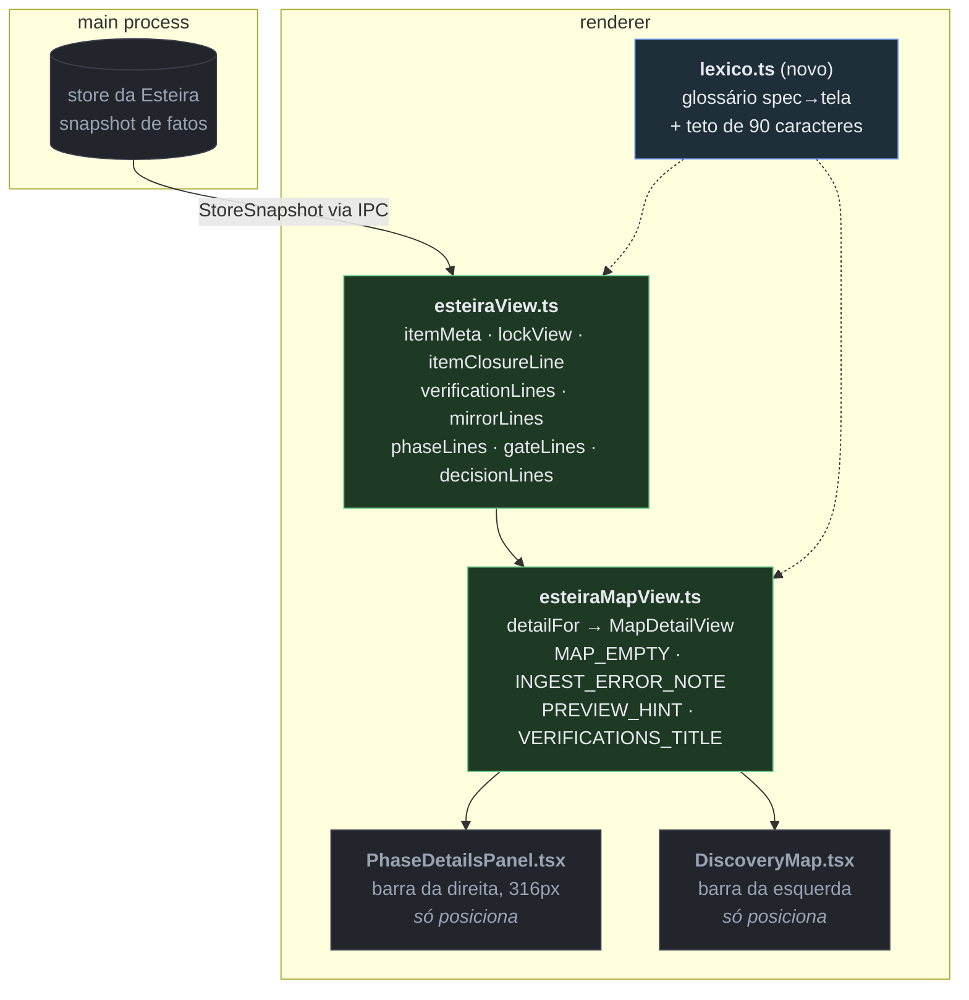

# Onde a mudança encosta — `wi-esteira4-textos-laterais`

Fase Design do item «Textos das barras laterais diretos e com sentido»
(plano `pln-esteira4-forma-e-leitura`, discovery `dsc-15a7e7f5-fbb`).
Companheiro do `mockup.html`, nesta mesma pasta: lá está **o que** o texto passa
a dizer; aqui, **por onde** ele passa e o que precisa mudar de forma para caber.

## O achado que decide o desenho

A arquitetura já está certa para este item: **nenhuma frase nasce no JSX**. Os
dois painéis laterais só posicionam texto pronto — está escrito nos dois
arquivos, e o código confere:

- `PhaseDetailsPanel.tsx`: *"Nenhum texto nasce aqui — tudo chega pronto de
  `esteiraMapView.ts`"*
- `esteiraView.ts`: *"A frase nasce aqui; a tela só posiciona"*

Consequência prática: **a reescrita é quase toda em um arquivo só**
(`esteiraView.ts`, 1690 linhas), com um punhado de constantes em
`esteiraMapView.ts`. Não há caça a string espalhada por componente. O risco do
item não é encontrar os textos — é a **forma do tipo** que os carrega.

## O fluxo, e o que muda em cada trecho

Legenda: **verde** = onde o texto é reescrito · **azul** = módulo novo ·
**cinza** = não deve mudar neste item.

## A fronteira que precisa mudar de forma

A regra nº 1 do mockup — *uma linha, um fato* — não cabe num `string`. Quem
carrega frase corrida hoje precisa virar par principal/secundário. O padrão
**já existe no arquivo** (`VerificationLineView` e `MirrorLineView` são
`{ text, detail }`); este item o estende a quem ficou de fora:

| Produtor (`esteiraView.ts`) | Hoje | Passa a ser | Quem consome |
|---|---|---|---|
| `itemMeta()` | `string` de até ~120 chars com 5 fatos | `ItemMetaView` — campos separados (`itemType`, `state`, `repo`, `inherited`, `lock`) para a tela desenhar chips | `MapDetailView.subtitle` / `.summary` |
| `lockView().line` | `string` com 2–3 orações | `{ fields: KV[], nextLine: string }` | seção "Situação" do painel |
| `itemClosureLine()` | `string` juntando fato + regra do ciclo | `{ line, hint }` — `hint` vai para `title=` | seção "Como terminou" |
| `MAP_EMPTY`, `MAP_EMPTY_NO_STORE`, `INGEST_ERROR_NOTE`, `PREVIEW_HINT` | `string` única | `{ line, detail }` | vazio do mapa e nota de ingestão |
| `verificationLines`, `mirrorLines`, `gateLines` | **já** `{ text, detail }` | só o vocabulário muda | inalterado |

`PhaseDetailsPanel.tsx` e `DiscoveryMap.tsx` **mudam de JSX** para desenhar
chips e pares chave/valor, mas continuam sem originar frase — a invariante do
repo permanece.

## O módulo novo, e por que ele é pequeno

`src/renderer/src/Esteira/lexico.ts` existe por um motivo só: o glossário do
mockup (trava → em uso, espelho → o board ainda não recebeu, …) é uma decisão
de produto que vai ser consultada de novo a cada fase nova do catálogo. Deixá-lo
espalhado em literais dentro de 1690 linhas é como o `Set` de fases duplicado
que a captura do batch n8 encontrou — duas cópias, uma esquecendo `design`.

Ele **não** é uma camada de i18n e não deve virar uma: um arquivo de constantes
nomeadas mais a função que aplica o teto de 90 caracteres. Se ele começar a
receber lógica de negócio, o desenho está errado.

## Onde a mudança é conferível

- `tests/esteiraView.test.ts` e `tests/esteiraMapView.test.ts` — os testes de
  frase já existem por função; a reescrita os atualiza e é onde o teto de 90
  caracteres vira asserção mecânica (um teste que varre as frases produzidas e
  falha na primeira que passar do teto).
- O mockup como referência visual: `design/esteira4-textos-laterais/mockup.html`.

## O que este design NÃO decide

- **Layout, cor e tipografia** das barras: fora do escopo do item. O mockup
  reusa a forma atual de propósito, para o diff ser só de texto.
- **O mapa de grafos**: é o item irmão `wi-esteira4-mapa-grafos`, que já tem
  motor e diagrama próprios. Se as duas branches encostarem no mesmo arquivo, é
  em `esteiraMapView.ts` — o mapa mexe na topologia (`buildMapView`, `levels`),
  este item mexe nas frases (`detailFor`, constantes). Conflito esperado: baixo,
  mas real.
- **O painel de runs headless**: o terceiro item do plano, que depende do motor
  da rodada 012.
