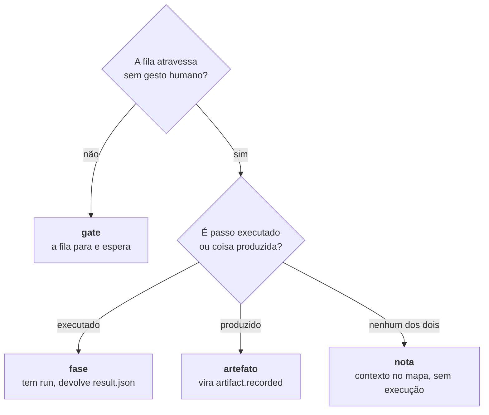

# Catálogo das seis fases da esteira — 012 Esteira 4.0

**Status:** 🟢 **DECIDIDA** (2026-08-08) — o texto normativo está escrito e as três
pendências de alcance (`[P-1]`…`[P-3]`) foram **ratificadas ao vivo pelo Alexandre**
na mesma data, na sessão da fase Implementar, cada uma pela recomendação da seção 7.
Nenhuma pendência de alcance segue aberta.
**Item:** `wi-esteira4-catalogo-fases` · plano `pln-esteira4-catalogo-e-grafo` ·
discovery `dsc-15a7e7f5-fbb`.
**Item irmão (molde):** o formato do arquivo `esteira.grafo`. Este catálogo é a
**fonte**; o formato é o **molde** que a serializa. Onde os dois falarem do mesmo
assunto, vence este.

**Sucede a 010.** A 010 trocou o modelo de estado (o app passou a ter estado
próprio, alimentado por fatos declarados). Esta spec redefine **o que se percorre**
com aquele estado. Onde as duas discordarem sobre nome, ordem ou número de fases,
vence esta; sobre contrato, store e fatos, continua valendo a 010.

> **Legenda de proveniência:** `[D-n]` decisão do dono, fechada ao vivo no Discovery
> de 07/08 — é requisito, não inventar além disto · `[F-n]` resolução de **forma**,
> proposta pela fase Design de 08/08 e aqui transformada em texto normativo ·
> `[P-n]` pergunta de **alcance** devolvida pelo Design, **ratificada pelo dono em
> 08/08** — vale como requisito; o id foi mantido para a rastreabilidade com o
> Design e com o item irmão · `[E]` evidência medida em disco/código, com caminho.

Insumos: as 11 decisões do Discovery, o grafo exportado da mesa
(`.esteira/plano/pln-esteira4-catalogo-e-grafo/grafo-mesa.json` — 12 nós, 12
arestas), e os dois artefatos da fase Design
(`.esteira/design/wi-esteira4-catalogo-fases/`).

---

## Problema

**A esteira virou um lançador manual.** Depois de três frentes reais — o dogfooding
da 010, as três etapas da 011 e a esteira rodando em outro repo — o que sobrou é um
painel que exige um gesto humano por item em Implementar, serializa o que poderia
correr junto, e não envia o próprio Enter na sessão que ele mesmo abre.

O defeito não é de tela: é de **catálogo**. Enquanto "fase" for uma linha de menu
que uma pessoa escolhe, cada item precisa de alguém para escolher — e a fila não
tem como andar. Uma fila só anda sozinha quando existe um grafo que diz **o que vem
depois do quê** e **onde é obrigatório parar**. Esta spec escreve esse grafo e
nomeia cada parada.

---

## 1. O grafo canônico de um plano

O grafo abaixo é **fixo**: ele não varia por plano nem por repo. O que varia por
plano é o grafo de **cards** (o `esteira.grafo`, item irmão); o que está aqui é o
caminho que **cada card** percorre.

```mermaid
flowchart LR
  DISC["Discovery<br/><i>gate</i>"]
  PLAN["Plano<br/><i>gate</i>"]
  DES["Design<br/><i>fase</i>"]
  DESOK["Você valida o Design<br/><i>gate</i>"]
  IMPL["Implementar<br/><i>fase · 0% humana</i>"]
  PRSTG(["PR para staging<br/><i>artefato</i>"])
  MERGE["Fila de merge<br/><i>fase</i>"]
  SUITE["Suíte + build + e2e<br/><i>fase · 1× por plano</i>"]
  VLOC["Validar — teste local<br/><i>gate</i>"]
  FIX["Fix<br/><i>passo da Validar</i>"]
  VSTG["Validar staging<br/><i>passo da Validar</i>"]
  CONC["Concluir + Documentar<br/><i>gate</i>"]
  STOP(["Chama o dono<br/><i>teto estourado</i>"])

  DISC --> PLAN
  PLAN -->|"tem decisão de estrutura"| DES
  PLAN -->|"não tem"| IMPL
  DES --> DESOK --> IMPL
  IMPL --> PRSTG
  IMPL -->|"/no-mistakes passou"| MERGE --> SUITE --> VLOC
  VLOC -->|"achou defeito"| FIX
  VLOC -->|"nada a corrigir"| VSTG
  FIX --> VSTG
  VSTG -->|"falhou · rodada < 3"| FIX
  VSTG -->|"passou"| CONC
  VSTG -.->|"rodada 3 falhou"| STOP

  classDef gate fill:#1c232c,stroke:#e8b44c,color:#d7dde5
  classDef fase fill:#151a21,stroke:#28303b,color:#d7dde5
  classDef art fill:#1c232c,stroke:#5fb0a8,color:#d7dde5,stroke-dasharray:3 3
  class DISC,PLAN,DESOK,VLOC,CONC gate
  class DES,IMPL,MERGE,SUITE,FIX,VSTG fase
  class PRSTG,STOP art
```



### Nó do grafo ≠ fase do catálogo

O grafo tem treze nós; o catálogo tem **seis fases**. Não é contradição, é a
diferença entre *o que se percorre* e *o que se dispara*:

- **fase do catálogo** = tem skill própria, tem `run-input.json`, devolve
  `result.json`. São seis: Discovery, Plano, Design, Implementar, Validar e
  Concluir (esta última com a Documentar dissolvida dentro, `[D-10]`).
- **nó do grafo** = uma parada no caminho. Alguns nós são fases; outros são
  **passos internos** de uma fase (Fix e Validar staging vivem dentro da Validar),
  **artefatos** (o PR para staging) ou **etapas de plano**, com cardinalidade
  diferente da do card (a suíte roda uma vez por plano, não uma por card).

Confundir os dois é o que faz uma fila tentar abrir sessão para um PR.

---

## 2. Taxonomia de nó — quatro tipos, um critério cada `[F-4]`

A mesa exportou três tipos (`gate`, `fase`, `nota`) e usou "artefato" só no
vocabulário. O grafo precisa de quatro, e a pergunta que separa é sempre a mesma:



**Regra normativa para o motor:** só nó de tipo `fase` gera `run-input.json`. Gate
gera espera, artefato gera fato, nota não gera nada. Um motor que dispare qualquer
outro tipo está errado — e o erro é do motor, não do grafo.

Consequência já resolvida `[F-4]`: **Discovery e Plano são `gate`**, não `fase`,
apesar de terem skill. O critério não é "tem skill", é "a fila atravessa sozinha?"
— e os dois só terminam com decisão humana ao vivo. É o mesmo critério que faz
`Você valida o Design`, `Teste local` e `Concluir` serem gates: **um critério,
cinco aplicações**.

> Uma fase pode ser gate. Ter `run-input.json` e exigir gesto humano são coisas
> independentes: o gate diz que **a fila não segue sozinha**, não que não haja
> sessão.

---

## 3. As seis fases

Para cada fase: **o que exige** para poder rodar, **o que faz**, **o que devolve**
(fatos do contrato v1 — nomes exatos), e **quantas vezes roda**.

### 3.1 Discovery — `gate`

| | |
|---|---|
| **Exige** | um assunto cru. Repo é opcional: Discovery investiga um problema, não um repositório. |
| **Faz** | dimensiona o problema e reduz incerteza — protótipo, spike, ADR, research, formulário para o cliente. Entrevista **ao vivo**, na sessão. |
| **Devolve** | `discovery.recorded`, os `plan.recorded` que nasceram dali, `decision.recorded` por decisão tomada ao vivo, `note.recorded` para as perguntas que ficaram abertas, `phase.completed`. |
| **Roda** | 1× por assunto. Reabrir é um run novo, não uma edição do anterior. |

Discovery é gate porque **fecha com decisões humanas**, não com um documento
inferido. `[D]` A saída mínima é: os planos, e as perguntas que a fase seguinte não
pode inventar resposta.

### 3.2 Plano — `gate`

| | |
|---|---|
| **Exige** | **um assunto fechado** — um só, e inteiro (emenda de 09/08, abaixo). Consome um, não vários. |
| **Faz** | quebra o plano em itens; gera tasks e, quando o alvo é processo agêntico, evals; declara a **sequência de merge** e o que se sobrepõe em conflito `[D]`; **roteia cada item**: Design ou Implementar. |
| **Devolve** | `work_item.recorded` (um por item, com tipo e repo alvo — item de código sem repo não entra `[D-6]`), `decision.recorded` da sequência de merge e do roteamento, `artifact.recorded` do `esteira.grafo` do plano, `phase.completed`. |
| **Roda** | 1× por plano. |

> **Emenda ratificada pelo dono em 09/08, aplicada a este texto em 10/08.** A
> linha "Exige" dizia "**uma** spec/plano por completo". O insumo nem sempre é um
> documento — mas é sempre **um**, e sempre **inteiro**. A emenda troca o nome, não
> afrouxa a regra: dois assuntos num run continua proibido. O detalhamento do que
> um assunto fechado carrega está em `conversa.md`, seção 6; a correção deste texto
> foi ratificada como `[Q-2]` lá.

O Plano é o **único** lugar onde a ordem de merge se decide. A fila não reordena, e
o agente que resolver conflito imprevisto decide **pela spec** e registra o conflito
e o que decidiu `[D]` — quem revê é a Validar.

### 3.3 Design — `fase`, condicional

| | |
|---|---|
| **Exige** | um item **roteado a Design** pelo Plano, e as tasks dele. |
| **Faz** | discovery técnico da estrutura-alvo: API, tabelas, tools, infra. Produz mockup e diagrama de arquitetura, e **reescreve as tasks** do Plano quando a estrutura escolhida as invalida. |
| **Devolve** | dois `artifact.recorded` (mockup e diagrama). Quando um dos dois não se aplica, `note.recorded` com a justificativa — omissão silenciosa é recusada. `phase.completed`. |
| **Roda** | 0 ou 1× por item. **Zero é o caso comum.** |

**Design não é oferta livre `[D-11]`.** Item sem decisão de estrutura a tomar vai
direto para Implementar; a linha Design aparece **desabilitada com o motivo
escrito**, no mesmo padrão que já rege item sem repo alvo `[E]`
(`src/renderer/src/Esteira/esteiraView.ts:1301`) — não é exceção nova.

Regra de conflito entre os dois artefatos e esta spec: **forma** → vence o design,
sem abrandar; **alcance ou comportamento** → vence a spec, e a divergência vira
nota, não silêncio.

### 3.4 Implementar — `fase`, 0% humana

| | |
|---|---|
| **Exige** | um item com repo alvo e tasks; quando roteado a Design, o Design validado. |
| **Faz** | escreve código e teste na branch do item, em **worktree por card** `[D]`. Fecha com o gate barato por card — `/no-mistakes`: typecheck + testes dos arquivos tocados. Headless. |
| **Devolve** | `verification.recorded` do que dá para conferir — **inclusive o `/no-mistakes`, como kind `check`** `[P-3]` —, `artifact.recorded` do que ficou fora do código, `phase.completed`. Como **artefato**, o PR para staging `[F-3]`. |
| **Roda** | 1× por item; `complements_run_id` quando a mesma fase continua em sessão nova por orçamento de contexto. |

**`/no-mistakes` é o gate de saída desta fase, não uma fase `[P-3]`.** Ele não tem
skill própria, não tem gate humano, não tem handoff: é a verificação que a
Implementar escreveu e rodou, que o contrato já cobra dela. Por isso **não existe nó
`/no-mistakes` no grafo canônico** — existe a aresta `Implementar → Fila de merge`
condicionada a ele. Na trilha, ele aparece como o `check` que a Implementar declara.

**Dispensa nomeada `[D]`:** esta é a única fase autorizada a abrir PR, e só **para
staging**. PR para produção continua sendo ato humano, na Concluir. O PR de staging
é **artefato**, não fase `[F-3]`: é o que a fase produz, não um passo que a fila
percorre — e é essa distinção de tipo que impede a fila de tentar executá-lo.

### 3.5 Validar — `fase`

| | |
|---|---|
| **Exige** | o que a Implementar deixou, e o roteiro de e2e. |
| **Faz** | roda a verificação sobre o item. Contém o laço `fix ↔ validar staging` (seção 5). |
| **Devolve** | `verification.recorded` (kind `check` ou `review`), `artifact.recorded` do que a verificação produziu (relatório de review, roteiro de e2e), **um** `phase.completed` — o de `validar` —, `human_review.recorded` quando houve roteiro e2e visto por gente. |
| **Roda** | 1× por item, com até 3 rodadas internas do laço. |

**A Validar não documenta `[D-10]`.** O `phase.completed` de `documentar` é da
Concluir (seção 3.6), e é dela sozinha: um mesmo fato de fase declarado por duas
fases para o mesmo `subject` não tem de quem ser cobrado, e o motor não teria como
arbitrar.

> **Transição, nomeada de propósito.** A skill `esteira-validar` **3.0.0** é
> composta (`[E5]`) e declara os dois `phase.completed`; a `esteira-concluir`
> 3.0.0 não declara `documentar` nenhum. Da **4.0** em diante é o inverso, e é
> esta seção que vale. Enquanto a 3.0 rodar, ela segue declarando os dois — o
> histórico de runs até 08/08 tem essa forma, e não é erro de dado: é a versão
> anterior do catálogo.

**Nunca aprova, nunca mergeia, nunca marca sozinha um roteiro e2e como visto.** O
teste local é gate humano por construção: humano só onde não é determinístico — API
roda sozinha, front é o dono.

### 3.6 Concluir — `gate` (com Documentar dissolvida dentro) `[D-10]`

| | |
|---|---|
| **Exige** | verificação que **passou**. Sem ela, o emissor recusa. |
| **Faz** | fecha o ciclo do item. **O dono dá o merge de produção num gesto só**, sobre a leva concluída, e o agente executa na ordem declarada pelo Plano `[D]`. Aqui também nasce a documentação, com insumo de todas as fases. |
| **Devolve** | `verification.recorded` da evidência que passou, `artifact.recorded` do documento versionado, `gate.confirmed`/`human_review.recorded` do gesto humano, e **dois** `phase.completed` (`concluir` e `documentar`) no mesmo run. |
| **Roda** | 1× por item; um gesto humano por **leva**, não por item. |

Documentar deixa de ser linha do catálogo `[D-10]`: a fronteira que justificaria
fase separada — gate humano, olho novo, orçamento de contexto — não separa as duas.
A mecânica de fase que fecha dois assuntos numa sessão só já foi provada pela
Validar composta da 3.0 `[E]` — o que muda na 4.0 é **de quem** ela é.

---

## 4. As três paradas humanas — três, e só três

A fila para em exatamente três lugares no ciclo de um item, e cada um tem um motivo
que não é preguiça de automação:

| Parada | Por que uma pessoa |
|---|---|
| **Você valida o Design** | proposta de estrutura não passa sem alguém ver. Estrutura errada aceita em silêncio custa o plano inteiro. |
| **Teste local** (dentro da Validar) | o que não é determinístico. API roda sozinha; front é o dono. |
| **Concluir** | o merge de produção. Um gesto, sobre a leva. |

Discovery e Plano também são gates, mas eles **antecedem** o ciclo do item: são
onde o trabalho nasce, e ali a conversa é a fase inteira, não uma parada nela.

**Critério de aceite da tela:** nenhum passo automático pede clique para começar. O
que pede clique é parada humana, e é parada humana porque **uma pessoa precisa
decidir** — não porque o lançador não sabe se virar sozinho. É a dor que originou
esta spec, visível na própria tela.

---

## 5. O laço `fix ↔ validar staging`, com teto de 3 `[F-1]` `[D]`

O laço **vive dentro da Validar** e tem teto de **3 rodadas**, fechado pelo Plano.

```
achado no teste local ──▶ Fix ──▶ Validar staging ──┬── passou ──▶ Concluir
                          ▲                          │
                          └──── falhou · rodada < 3 ─┘
                                      │
                            rodada 3 falhou ──▶ a fila para e chama o dono
```

Duas costuras que o desenho da mesa não tinha e que este catálogo fecha `[F-1]`:

1. **A aresta de volta** `Validar staging → Fix`, com a condição `rodada < 3`. Sem
   a volta, o teto não tem o que limitar.
2. **A saída do teto estourado.** Sem ela, a fila não sabe parar — e uma fila que
   não sabe parar tenta a quarta.

**Requisito de tela:** o contador de rodadas é **parte da forma**, não detalhe de
log. Quem olha precisa saber em que rodada está *antes* de a fila desistir. Quando
o teto estoura, a tela mostra o último achado, a branch, e as duas saídas: ver as 3
rodadas, ou assumir na mão.

O teto está fechado em 3. **Quem conta** é `[P-2]`.

---

## 6. As quatro costuras entre o desenho da mesa e as decisões `[F-1]`…`[F-4]`

O grafo da mesa é a fonte da **forma**; as 11 decisões do Discovery são a fonte do
**alcance**. Divergiram em quatro pontos. A fase Design propôs a resolução como
desenho; aqui elas viram texto normativo:

| # | O que faltava | Como fica, normativo |
|---|---|---|
| `[F-1]` | O laço `fix ↔ validar` **não era ciclo**: as arestas iam `val-local → fix → val-stg`, sem volta. O teto de 3 regia um laço que o grafo não desenhava. | Aresta de volta `Validar staging → Fix` com condição `rodada < 3`, mais a saída do teto estourado (seção 5). |
| `[F-2]` | O `/no-mistakes` decidido entre Implementar e Validar **não tinha nó**. | É o gate barato **por card**, e a suíte roda **1× por plano** — cardinalidades diferentes não cabem no mesmo nó. Ratificado `[P-3]`: ele é **passo interno da Implementar**, não nó — a diferença de cardinalidade fica na aresta condicionada, e o `check` declarado é o que a trilha mostra. |
| `[F-3]` | O **PR para staging** aberto pela Implementar não aparecia nem como nó nem como artefato. | É **artefato** pendurado na Implementar. Tipos distintos é o que impede a fila de tentar "executar" um PR. |
| `[F-4]` | Discovery e Plano estavam `kind=gate`, não `fase`. | Ficam **gate**, pelo critério da seção 2 — os dois só terminam com decisão humana ao vivo. |

---

## 7. As três perguntas de alcance — ratificadas em 08/08

A fase Design devolveu três perguntas **de propósito**, para a spec não herdar
decisão tomada por acidente no desenho. As três foram levadas ao Alexandre ao vivo,
com a recomendação e o custo da alternativa, e **as três foram ratificadas pela
recomendação** em 2026-08-08. O que segue é requisito, não proposta.

### `[P-1]` Onde mora o roteamento Design | Implementar — ✅ ratificado

**Decisão: nos dois lugares, porque são duas perguntas diferentes.**

A pergunta "campo do item **ou** aresta condicional do grafo" mistura *onde mora a
condição* com *onde mora o dado*:

- **A condição** mora na **aresta do grafo canônico** (seção 1), que é fixo e vive
  em código. Ela é a mesma para todo item: "tem decisão de estrutura?".
- **O dado** varia por card, e por isso não pode ser aresta: as arestas do
  `esteira.grafo` são **dependências entre cards**, não caminhos de fase. Ele mora
  no **nó do card dentro do `esteira.grafo`**, escrito pelo Plano e versionado em
  `.esteira/` `[D]`.

**Custo da alternativa** (campo em `work_item.recorded`): o fato tem
`additionalProperties: false` `[E]`
(`src/shared/esteira/contract/v1/esteira-result.schema.json`), então um campo novo
**muda o contrato v1** — que esta spec promete não mexer. Guardar no grafo compra a
mesma coisa por zero.

O app **deriva** `needsDesign` do grafo ao ingerir, e a tela mostra a linha Design
desabilitada com o motivo. Derivado, nunca guardado em duplicata — mesmo princípio
do `derivedStage` `[D-13]` da 010.

### `[P-2]` Quem incrementa o contador de rodadas do laço — ✅ ratificado

**Decisão: ninguém incrementa — o contador é derivado do log de fatos.**

A rodada é observável: é o número de runs da fase Validar do item cuja verificação
ficou `failed`. Guardar um contador, seja na Validar seja no motor, cria um segundo
lugar onde a verdade mora — e quando os dois discordam, a tela afirma uma inverdade.
Foi exatamente o modo de falha que a 010 extinguiu.

**Custo da alternativa** (campo mutável no item, escrito pela Validar ou pelo
motor): reinício do app, disparo manual repetido e run complementado passam a
poder somar ou perder rodada — e o teto de 3 vira aproximação.

### `[P-3]` `/no-mistakes` é fase própria ou passo interno da Implementar — ✅ ratificado

**Decisão: passo interno da Implementar, declarado como `verification.recorded`
(kind `check`) no `result.json` dela.**

Ele não tem skill própria, não tem gate humano, não tem handoff: é exatamente "a
verificação que a Implementar escreveu e rodou" — que o contrato já cobra dela.
Promovê-lo a fase criaria um run e uma sessão por card para rodar um typecheck,
gastando orçamento de contexto em algo que não decide nada.

**Divergência declarada com o Design, resolvida a favor da spec:** o diagrama e o
mockup desenham `/no-mistakes` como **nó de tipo `fase`**. Pela regra de conflito do
repo, forma é do design e **alcance é da spec** — e "é fase ou é passo?" é alcance.
Com a ratificação, **o nó sai do grafo canônico** (seção 1) e vira o gate de saída
da Implementar, na aresta `Implementar → Fila de merge`. Os dois artefatos do Design
ficam como registro do que foi proposto; onde eles mostram o nó, vale esta seção.

---

## 8. O que este catálogo toca no código, e o que não toca

| Componente | Este item… | Por quê |
|---|---|---|
| `PHASE_CATALOG` (`src/renderer/src/Esteira/esteiraView.ts:1301`) | **fixa as seis fases**; Documentar já saiu `[E]` | é a oferta da tela, e a oferta tem de espelhar o catálogo |
| Condição de roteamento do Design na tela | **não implementa aqui** | `[P-1]` está ratificado, mas o dado mora no nó do card dentro do `esteira.grafo` — e o formato desse arquivo é o **item irmão**. A tela só tem de onde ler quando ele existir; a dependência é de item, não de decisão |
| Skills `esteira-*-3` | **muda o conteúdo**, não a instalação | decisão do Discovery: as skills rodam sem o Donel |
| Contrato v1 (`esteira-result.schema.json`) | **não muda** | `run.phase` é string livre `[P-4 da 010]`; nenhum nome novo de fase exige schema novo |
| Motor da fila | **é consumidor** | o grafo é o molde; o motor percorre. Especificado pelo item irmão |
| `.esteira/` versionado | **ganha** o `esteira.grafo` por plano | decisão do Discovery |

---

## 9. Como este catálogo se verifica

Um catálogo que só existe em prosa volta a divergir do código na primeira semana.
A regra "a oferta da tela espelha o catálogo" é mecânica desde já:

- `tests/esteiraCatalogoSeisFases.test.ts` — pina as seis fases da seção 3: nomes,
  ordem, o assunto de cada uma, e a **ausência** de `documentar` como linha
  independente. Uma sétima fase, um rename, ou a volta da Documentar quebram o
  teste com a referência a esta spec no erro.

O que **não** dá para pinar por teste, e por isso é gate de gente: se as seis fases
são as certas. Isso se responde na Validar, com o dono.
