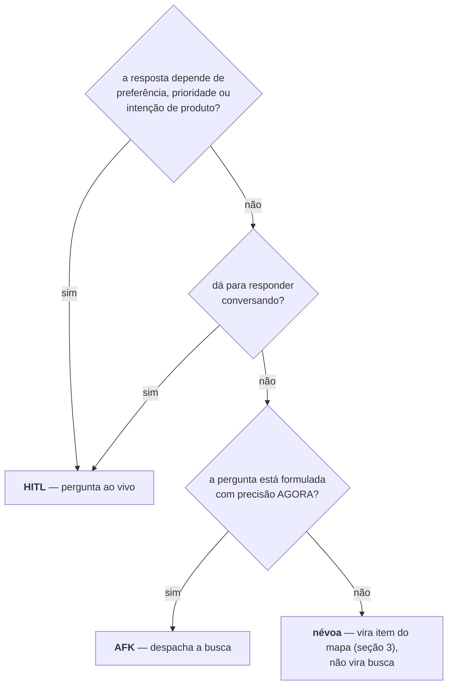

# Spec dos gates Discovery e Plano — a conversa com o humano dentro — 012 Esteira 4.0

**Status:** 🟢 **DECIDIDA** (2026-08-10) — o texto normativo está escrito e as quatro
perguntas de alcance da seção 9 (`[Q-1]`…`[Q-4]`) foram **ratificadas ao vivo pelo
Alexandre na mesma data**, cada uma pela recomendação apresentada com o custo da
alternativa — o mesmo rito que fechou as `[P-n]` do catálogo e as `[Q-n]` do motor.
Nenhuma pendência de alcance segue aberta.
**Item:** `wi-esteira4-conversa-spec` · plano `pln-esteira4-conversa-com-humano` ·
discovery `dsc-15a7e7f5-fbb`.
**Fonte de alcance:** `specs/012-esteira-4/catalogo.md` (🟢 decidida) — esta spec
**detalha** as §3.1 e §3.2 dele; onde os dois falarem do mesmo assunto e não houver
emenda ratificada, vence o catálogo. A única exceção está declarada na seção 6.1.
**Fonte de forma:** os dois artefatos da fase Design
(`.esteira/design/wi-esteira4-conversa-spec/` — mockup dos dois gates e diagrama de
arquitetura). Forma → vence o design, sem abrandar; alcance ou comportamento →
vence esta spec, e a divergência vira nota, não silêncio.
**Irmãs:** `catalogo.md` (o grafo canônico e as seis fases) e `motor.md` (a fila que
percorre o que estes dois gates escreveram). Esta spec fica **à esquerda** do
`esteira.grafo`; o motor, à direita.

> **Legenda de proveniência:** `[D-n]` decisão do dono, fechada ao vivo no Discovery
> de 07/08 · `[P-n]` alcance ratificado em 08/08 (catálogo, §7) · `[E-n]` emenda do
> dono ratificada em 09/08 · `[F]` resolução de forma vinda da fase Design de 09/08
> deste item · `[R]` mecânica adaptada de uma referência lida (dossiê em
> `.esteira/plano/pln-esteira4-conversa-com-humano-ctx.md`) · `[Q-n]` pergunta de
> alcance desta spec, **ratificada pelo dono em 10/08** — vale como requisito; o id
> foi mantido para a rastreabilidade com a fase Design · `[EV]` evidência medida em
> disco/código, com caminho.

---

## Problema

O catálogo disse **que** Discovery e Plano são gates. O motor disse **o que**
acontece depois que eles fecham. Falta o que acontece **dentro** deles — e é ali que
mora o defeito que a esteira 3.0 produziu na prática: um agente que "faz discovery"
lendo código e devolvendo um plano pronto para carimbar, sem ter perguntado nada.
Um plano que ninguém decidiu é indistinguível de um plano que alguém decidiu — até
a hora de implementar, quando a decisão que ninguém tomou já custou uma leva.

Esta spec fixa a **costura central** dos dois gates: o que a fase **pergunta ao
vivo** e o que ela **vai buscar assíncrono** — e por que material buscado volta
sempre como insumo de decisão, nunca como decisão tomada. Ela é o molde das skills
`esteira-discovery-4` e `esteira-plano-4`; nada de código nasce neste item.

---

## 1. Os dois trilhos — HITL e AFK numa sessão só `[R: wayfinder]`

Toda pergunta que aparece num dos dois gates cai em exatamente um dos dois trilhos.
A régua é do wayfinder, adaptada: **quem decide no fim.**

| Trilho | Sigla | Quem decide | Bloqueia a conversa? | Produz |
|---|---|---|---|---|
| **Ao vivo** | HITL | o dono, na sessão | **sim** — é a conversa | `decision.recorded` |
| **Assíncrono** | AFK | ninguém — a busca **informa** | não | `artifact.recorded` (material) |

**Regra normativa:** não existe caminho de material assíncrono para
`decision.recorded`. Protótipo, spike, ADR, research e formulário ao cliente
produzem **material**; o material volta à mesa e vira **uma pergunta melhor** `[F]`.
Um agente que leia o resultado de um research e registre uma decisão a partir dele
está errado — e o erro é grave porque é invisível: a decisão fica no log com a
mesma cara de uma decisão tomada por gente.

### 1.1 Como se classifica uma pergunta

Os três critérios, na ordem, e cada um com o defeito que ele evita:

1. **Intenção é sempre HITL.** Preferência, prioridade e comportamento de produto
   não têm resposta descobrível. É a mesma régua do `ask-user` da `no-mistakes`
   `[R]`: o que desafia intenção deliberada escala para uma pessoa, e escala
   **verbatim** — a pergunta chega ao dono como ela é, sem paráfrase nem
   pré-julgamento do agente.
2. **O que se responde conversando, responde-se conversando.** Despachar uma busca
   para o que uma frase do dono resolveria é gastar sessão e adiar a decisão.
3. **Busca exige pergunta formulada.** É o *fog of war* do wayfinder `[R]`: se você
   não consegue enunciar a pergunta com precisão agora, não há o que buscar — há
   névoa. Névoa vira item do mapa (seção 3); despachar um agente contra névoa
   devolve prosa plausível sobre nada.

---

## 2. Discovery — o gate onde o trabalho nasce

Herda a §3.1 do catálogo (exige um assunto cru, repo opcional, roda 1× por assunto,
reabrir é run novo). O que esta spec acrescenta é o **rito**.

### 2.1 O rito da entrevista

- **Uma pergunta por vez, e a resposta antes da próxima.** Bateria de perguntas
  numeradas é formulário, não entrevista: o dono responde a primeira, a terceira
  muda de sentido, e ninguém percebe.
- **Questionador ativo, não estenógrafo** `[R: discovery IA Hub]`. Quando o assunto
  chega como solução ("quero um botão que…"), a fase pergunta pelo problema antes de
  aceitar a solução. Se o dono insistir na solução depois de confrontada, isso vira
  `decision.recorded` **com a insistência declarada no texto** — decisão do dono é
  decisão, e o registro diz que foi dele contra a recomendação.
- **Nada de decisão inferida.** O que o dono não decidiu ao vivo não vira
  `decision.recorded`. Vira `note.recorded` de pergunta em aberto — e a fase
  seguinte tem **proibição escrita** de inventar resposta para ela.
- **O palpite das specs sai como `note.recorded`, nunca como `plan.recorded` extra**
  `[F]`. Palpite promovido a registro de plano é palpite promovido a decisão sem
  ninguém ter decidido. Quem confirma é o Plano, ao vivo.

### 2.2 O que a Discovery devolve, e o que cada fato significa

| Fato | Cardinalidade | Significa |
|---|---|---|
| `discovery.recorded` | 1 | o assunto foi dimensionado |
| `plan.recorded` | ×N | um assunto **fechado** nasceu daqui (seção 6) |
| `decision.recorded` | ×N | uma decisão tomada **ao vivo**, uma por fato |
| `artifact.recorded` | ×N | material assíncrono que voltou (seção 7) e o mapa (seção 3) |
| `note.recorded` | ×N | pergunta em aberto · palpite de spec · suposição declarada |
| `phase.completed` | 1 | `done` · `inconclusive` se o orçamento acabou antes |

Nenhum fato novo: o contrato v1 não muda `[EV]`
(`src/shared/esteira/contract/v1/esteira-result.schema.json`).

---

## 3. Quando o assunto não cabe numa sessão — o mapa `[R: wayfinder]`

Assunto grande não vira Discovery mais longa; vira **mapa**. O teste é o mesmo da
seção 1.1: o que está formulado vira **item**, o que não está fica como **névoa
nomeada**.

- O mapa é **índice**: cada decisão vive num lugar só, e o mapa aponta. Decisão
  copiada em dois lugares diverge na primeira edição.
- **Névoa não regride.** Item que saiu da névoa (virou pergunta formulada, foi
  respondido, ou saiu de escopo) **não volta** para névoa. Voltar é como um mapa
  passa a nunca terminar.
- O mapa é `artifact.recorded` da Discovery, versionado em `.esteira/` `[D]`. Ele
  **não** é o `esteira.grafo`: o grafo é do Plano, tem cards e dependências entre
  eles; o mapa é da conversa, tem perguntas e o que já se sabe.
- Mapa aberto **não bloqueia** o Plano dos assuntos que já fecharam. O que bloqueia
  é assunto não fechado — e assunto na névoa é, por definição, não fechado.

---

## 4. Quando o Discovery pode fechar — a régua

Um gate sem régua fecha quando o agente se cansa. A régua tem duas partes, e a
segunda é do dono.

**Parte mecânica — checklist por tipo de assunto** `[R: discovery IA Hub]`. O tipo
do assunto define os campos obrigatórios; o que falta é listado por nome, não por
score. Cinco tipos, herdados da referência e adaptados ao vocabulário da esteira:

| Tipo | Obrigatórios para fechar |
|---|---|
| `bugfix` | sintoma observado · onde reproduz · repo alvo · o que é "consertado" |
| `ajuste` | o que muda · o que **não** muda · repo alvo |
| `evolucao` | problema · quem sente · o que existe hoje · o que passa a existir |
| `feature` | problema · quem sente · alcance · fora de escopo · repo alvo |
| `produto` | problema · quem sente · alcance · fora de escopo · riscos · faseamento |

Campo obrigatório vazio ⇒ o gate **não fecha** com `done`. Ele fecha com
`inconclusive` e a lista do que falta em `note.recorded` — meia entrega declarada é
informação; meia entrega escondida é retrabalho.

**Parte humana — o dono fecha.** Checklist completo é condição necessária, não
suficiente: quem diz que o assunto está entendido é ele, ao vivo. É o que faz da
Discovery um gate e não uma fase `[F-4]`.

**O que esta spec recusa de propósito:** o *score de qualidade* da referência
(0.3×determinístico + 0.7×LLM, com threshold por estágio) `[R]`. Um número que
mistura contagem de campo com opinião de modelo não é auditável — quando ele diz
`7.4`, ninguém sabe o que fazer com o `.4`, e o gate passa a depender de um juízo
que não se pode conferir. Lista de campos faltando responde a mesma pergunta e diz
**o que fazer**. Ratificado em `[Q-3]`.

---

## 5. Plano — um assunto fechado por vez

Herda a §3.2 do catálogo (roda 1× por plano; item de código sem repo não entra
`[D-6]`; a sequência de merge nasce aqui e só aqui). O que esta spec acrescenta:

### 5.1 As quatro perguntas do Plano, nesta ordem

1. **Em que itens isto se quebra?** Cada item nasce com **tipo** e **repo alvo**
   explícitos. Item de código sem repo não entra — é a regra que impediu a fase
   aberta no repo errado.
2. **Quais tasks por item — e quais evals?** `evals` quando o alvo é **processo
   agêntico** (uma skill, um prompt, um agente): o que se verifica ali não é
   assert, é comportamento sob variação. Alvo determinístico leva teste, não eval.
3. **Qual a sequência de merge, e o que se sobrepõe em conflito?** A fila não
   reordena. O agente que topar com conflito imprevisto decide **pelo assunto do
   plano**, registra o conflito e o que decidiu — quem revê é a Validar `[D]`.
   (O vocabulário segue o catálogo corrigido: onde se lia "pela spec", leia "pelo
   assunto que este Plano consome".)
4. **Cada item vai para Design ou direto para Implementar?** Roteamento é
   `decision.recorded`, **não inferência do motor** `[P-1]`. Design é 0 ou 1× por
   item e **zero é o caso comum** `[D-11]`.

### 5.2 O Plano não entrevista de novo `[R: to-spec]`

O Plano **sintetiza um assunto já fechado**; ele não reabre o que a Discovery
decidiu. Ele pergunta ao vivo só o que é **dele**: a quebra em itens, as tasks, a
sequência de merge, o roteamento. Se, ao quebrar, aparecer uma decisão de alcance
que a Discovery não tomou, o Plano tem duas saídas — e **inventar não é uma delas**:

- decidir **ao vivo com o dono** ali mesmo, se for pergunta pequena e o dono estiver
  na sessão (é gate: ele está), registrando `decision.recorded`;
- devolver o assunto à Discovery, com `note.recorded` dizendo o que falta — quando
  a pergunta é grande o bastante para mudar a quebra inteira.

### 5.3 O que o Plano devolve

`work_item.recorded` ×N (tipo + repo alvo), `decision.recorded` da sequência de
merge e do roteamento (uma por item), `artifact.recorded` do `esteira.grafo` do
plano, `note.recorded` do que ficou aberto, `phase.completed`. É exatamente o que o
motor consome — e nada além disso chega à fila.

---

## 6. O "assunto fechado" — a forma do que atravessa `[E-1]`

### 6.1 Emenda ratificada, e a correção do catálogo

O catálogo, §3.2, diz que o Plano exige "**uma** spec/plano por completo". A emenda
ratificada pelo dono em **09/08** troca isso por "**um assunto fechado** — um só e
inteiro". O motivo: o insumo nem sempre é um documento; mas é sempre **um**, e
sempre **inteiro**.

Esta spec **adota a emenda**. A correção do texto do catálogo **já foi feita na
`staging`**, pelo próprio item do catálogo (commit `61fcb38`, 09/08) e com redação
mais forte que a proposta aqui: além da linha "Exige", ele acrescenta o parágrafo
*"'Um assunto fechado' não quer dizer 'uma spec'"* e a regra de leitura "onde este
catálogo disser 'spec', leia 'o assunto que este Plano consome'". **Vale a versão
da `staging`** — esta spec não a reescreve; o que ela faz é detalhar, na seção 6.2,
o que esse assunto carrega. O que a emenda **não** afrouxa: dois assuntos num run
continua proibido — é o que produz grafo com dependência inventada entre coisas que
nunca se falaram.

### 6.2 O que um assunto fechado carrega

Adaptado do handoff Parte A/B1/B2 da referência `[R: discovery IA Hub]`, sem a
camada de publicação:

| Seção | É | Mutável pelo Plano? |
|---|---|---|
| **O problema** | o que dói, quem sente | não |
| **As decisões** | `decision.recorded` da Discovery, uma a uma, com quem decidiu | **não** — decisão tomada não se revisita |
| **Fora de escopo** | o que foi deliberadamente deixado de fora | não |
| **Perguntas em aberto** | `note.recorded` — o que ninguém decidiu | não se responde por dedução |
| **Palpite de quebra** | sugestão de itens/specs | **sim** — é insumo bruto, não decisão |
| **Material** | ponteiros para protótipos, research, ADRs | leitura |

A fronteira **decisões (imutáveis) × palpite (livre)** é o que impede os dois
defeitos simétricos: o Plano reabrindo o que já se decidiu, e o Plano carimbando um
palpite como se fosse decisão. É o mesmo papel do `--intent` da `no-mistakes` `[R]`
— o que atravessa carrega o **porquê**, não só o **quê**.

---

## 7. Material assíncrono — despacho, volta e falha

### 7.1 Despacho

Uma busca AFK só é despachada com a **pergunta escrita antes** `[R: prototype]`.
O despacho registra: a pergunta, o tipo de busca, e o que se vai fazer com a
resposta. Busca despachada sem pergunta escrita volta com material que não informa
decisão nenhuma — e o custo já foi pago.

Os quatro tipos e o que cada um exige de volta:

| Tipo | Volta com | Regra própria |
|---|---|---|
| `prototype` | a resposta à pergunta declarada | **throwaway desde o dia 1**, nomeado como tal; o código não funde no real por esta fase `[R]` |
| `research` | 1 arquivo `.md`, **fontes primárias com citação por claim** `[R]` | roda em subagente de fundo |
| `spike` / `ADR` | a alternativa avaliada e o custo dela | |
| `formulário` | a resposta de quem está fora da sessão | volta como material, **nunca** como decisão de terceiro |

### 7.2 Volta

O material volta à mesa como `artifact.recorded` e **informa uma pergunta**. A
decisão que ele informou continua sendo HITL. Quando um protótipo encapsula a
decisão melhor que prosa, ele é citado inline **com a origem declarada** `[R:
to-spec]` — o ponteiro não substitui a decisão registrada.

### 7.3 Quando o material não volta

Duas exigências que se contradizem nas fontes, e que esta spec concilia:

- o desenho da fase Design diz que **o gate não fecha** com material despachado sem
  volta `[F]`;
- a referência do IA Hub diz que o handoff **nunca espera pesquisador morto**, e
  marca a ausência explicitamente `[R]`.

**Como fica, normativo:** a busca AFK tem **prazo declarado no despacho**. Vencido o
prazo, o gate **não trava**: a ausência vira `note.recorded` com o marcador
`[MATERIAL AUSENTE — <pergunta> não voltou]`, e a decisão que ele ia informar tem
duas saídas, ambas às claras — decidir sem ele (registrando que se decidiu sem) ou
deixar a pergunta em aberto para a fase seguinte. **O que não pode acontecer é a
decisão sair como se o material tivesse voltado.** Ratificado em `[Q-4]`.

---

## 8. Onde as cinco skills de referência entram `[F]`

O desenho fixou **onde** cada uma se encaixa; o alcance — se elas entram como
dependência declarada, cópia versionada ou apenas inspiração — era desta spec, e
foi ratificado em `[Q-1]`: **inspiração adaptada**, nenhuma instalação, nenhuma
cópia. A tabela abaixo diz de qual skill veio cada padrão que virou texto normativo
aqui; ela **não** é lista de dependência.

| Skill | Gate | Papel |
|---|---|---|
| `wayfinder` | Discovery | mapa e fog of war quando o assunto não cabe numa sessão (seção 3) |
| `prototype` | Discovery | a pergunta é de forma ou de modelo |
| `research` | Discovery | a pergunta é de fato externo |
| `grill-with-docs` | Plano | a entrevista que fecha o assunto |
| `to-spec` | Plano | sintetiza a conversa já havida — **não entrevista de novo** |

A ordem `grill-with-docs → to-spec` é normativa, não estética: `to-spec` declara que
não entrevista, e rodá-la num assunto ainda não grelhado produz um documento que
parece fechado e não é — o "documento inferido" que a §3.1 do catálogo proíbe.

**Nenhuma das cinco está instalada no `donel-dev`** `[EV]` — elas vivem em
`C:/Users/xansd/seazone/spotsys/.claude/skills/`.

---

## 9. As quatro perguntas de alcance — ratificadas em 10/08

Quatro perguntas que esta spec **não** decidiu sozinha. As quatro foram
apresentadas ao Alexandre ao vivo, na sessão da fase Implementar deste item, cada
uma com a recomendação e o custo da alternativa, e **as quatro foram ratificadas
pela recomendação** em 2026-08-10 — o mesmo rito das `[P-n]` do catálogo e das
`[Q-n]` do motor. O que segue é requisito, não proposta.

### `[Q-1]` As cinco skills: dependência, cópia ou inspiração? — ✅ ratificado

**Decisão: inspiração adaptada, com o alcance escrito nesta spec — nenhuma
instalação, nenhuma cópia.**

O que atravessa das cinco é o **padrão de decisão** (HITL/AFK, fog of war, "não
entrevista de novo", "pergunta escrita antes de codar"), e ele já está nas seções 1,
3, 5.2 e 7 como texto normativo. As skills em si carregam acoplamento ao Spotsys que
a cerca do dossiê proíbe: labels `wayfinder:*`, child issues do GitHub, `?variant=`
no Next router, `/setup-matt-pocock-skills`.

**Custo das alternativas:** *dependência declarada* põe o `donel-dev` a depender de
um checkout de outro repo que ele não versiona nem testa — quebra silenciosa na
primeira mudança lá. *Cópia versionada* cria cinco arquivos que ninguém mantém e que
divergem da origem sem aviso; e o que se copiaria é justamente a parte acoplada.

### `[Q-2]` Corrigir o texto do catálogo, ou só declarar a divergência? — ✅ ratificado

**Decisão: corrigir o catálogo** — e a correção **já existe na `staging`**, feita
pelo item do catálogo em 09/08 (`61fcb38`), não por este item. O que esta spec
propunha era a mesma decisão com redação menor; ela foi descartada no merge a favor
da versão de lá, que diz mais (ver seção 6.1). A decisão do `[Q-2]` fica cumprida;
muda só quem a executou.

A emenda já foi ratificada em 09/08 — é requisito. Deixar a §3.2 dizendo "uma
spec/plano por completo" é deixar duas fontes normativas discordando sobre o insumo
do Plano; a próxima sessão que ler o catálogo primeiro vai obedecer o texto velho.
A correção é uma frase, e o commit carrega o porquê.

**Custo da alternativa** (só declarar a divergência aqui): o catálogo continua
sendo lido como fonte primária — e ele diz o contrário do que o dono ratificou.

### `[Q-3]` A régua de fechamento do Discovery: checklist, ou score? — ✅ ratificado

**Decisão: checklist por tipo (seção 4), sem score.**

Lista de campos faltando é auditável e diz o que fazer; um número composto de
contagem + opinião de modelo não é conferível e vira ritual. O gate humano continua
por cima dos dois.

**Custo da alternativa** (score combinado, como na referência): ele foi construído
para um contexto que a esteira não tem — stakeholder não-técnico, muitos assuntos
por semana, ninguém disponível para o gate ao vivo. Aqui o dono **está** na sessão:
o score responderia uma pergunta que ele responde melhor.

### `[Q-4]` Busca AFK que não volta: prazo com marcador, ou o gate trava? — ✅ ratificado

**Decisão: prazo declarado no despacho; vencido, marcador `[MATERIAL AUSENTE]`
e a decisão às claras (seção 7.3).**

**Divergência declarada com o Design, resolvida a favor da spec:** o diagrama de
arquitetura (§2) diz que "o gate não fecha enquanto houver material despachado sem
volta". Isso é **comportamento**, não forma — e pela regra de conflito do repo,
comportamento é da spec. Com a ratificação, vale a seção 7.3; o desenho fica como
registro do que foi proposto.

Travar o gate por causa de um subagente morto é dar a um processo de fundo o poder
de parar a conversa — o pior modo de falha possível num gate cuja razão de existir é
o dono estar presente.

**Custo da alternativa** (gate não fecha sem todo material): uma busca que morreu às
23h trava o assunto até alguém perceber; e a pressa de destravar é exatamente o que
faz alguém decidir sem o material **sem registrar** que decidiu sem.

---

## 10. O que esta spec toca no código, e o que não toca

| Componente | Este item… | Por quê |
|---|---|---|
| Spec dos gates (`specs/012-esteira-4/conversa.md`) | **escreve** — este arquivo | é o entregável do item: spec, não código |
| `catalogo.md` §3.2 | **não toca** — já corrigido na `staging` (`61fcb38`, 09/08) | a emenda de 09/08 é requisito e já está aplicada lá, com redação mais forte (`[Q-2]`, seção 6.1) |
| Skills `esteira-discovery-4` / `esteira-plano-4` | **não escreve** — item futuro | esta spec é o molde delas |
| Contrato v1 (`esteira-result.schema.json`) | **não muda** | todos os fatos citados já existem |
| Motor da fila | **não toca** | a fronteira da §1 do diagrama garante: conversa à esquerda do `esteira.grafo`, fila à direita |
| As cinco skills do Spotsys | **não instala, não copia** (`[Q-1]`) | o que atravessa é o padrão de decisão, já escrito aqui |
| Fase Design (estrutura) | **não decide** | segue aberta, é de outro item |

---

## 11. Como esta spec se verifica

- **Agora (este item):** revisão do dono — este documento é o objeto do gate. O que
  ele precisa ver é a régua da seção 1.1 (o que se pergunta × o que se busca), a
  fronteira decisões × palpite da seção 6.2, e as quatro respostas da seção 9.
- **Depois (nas skills):** o checklist por tipo da seção 4 é pinável por teste puro
  — dado um assunto sintético com campo faltando, `getMissingRequired()` devolve o
  nome do campo e o gate não fecha com `done`. A ordem `grill-with-docs → to-spec`
  e a proibição de `decision.recorded` a partir de material assíncrono são regras
  de skill, verificadas por revisão do texto da skill, não por teste.
- **O que não dá para pinar** e por isso é gate de gente: se a conversa foi boa.
