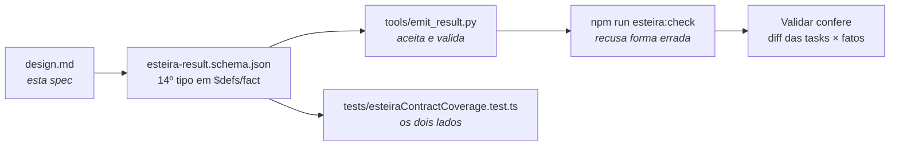
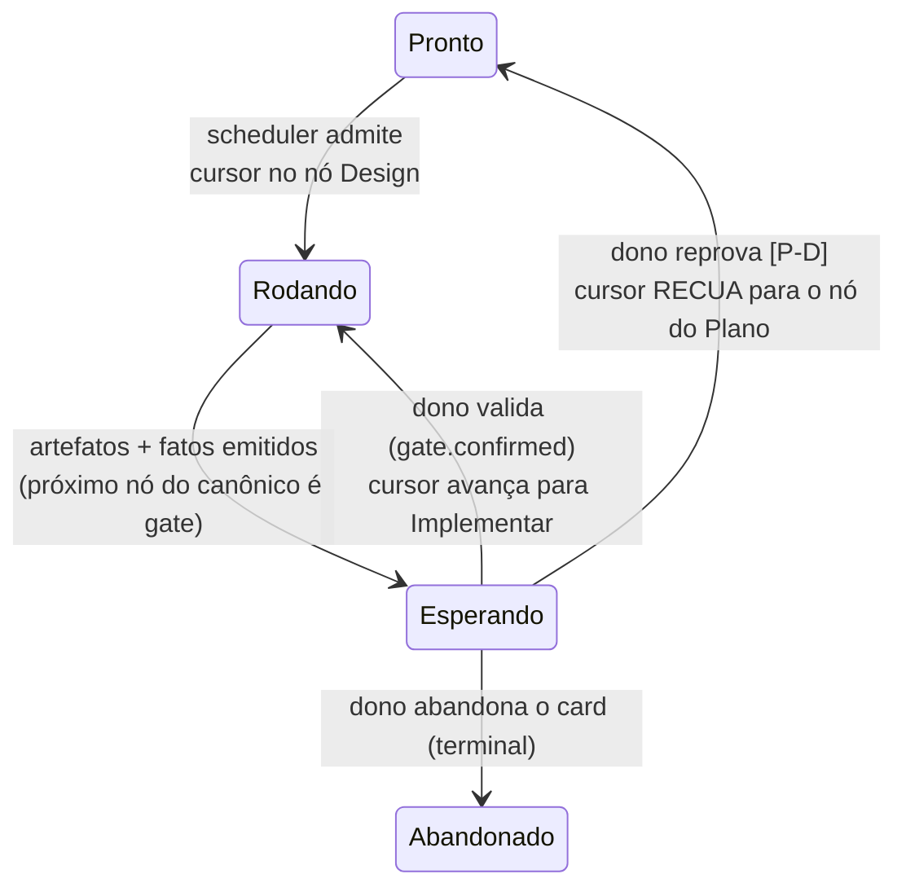

# Spec do miolo da fase Design — 012 Esteira 4.0

**Status:** 🟡 **ESCRITA, aguardando o gate** — o texto normativo está escrito
sobre as quatro respostas que o dono ratificou em 10/08 (`[P-A]`…`[P-D]`,
`design-research.md` §6), e devolve **duas** perguntas de alcance ainda abertas
(`[P-E]`, `[P-F]`, seção 8). Enquanto elas não fecharem, o status não vira 🟢 e
**nenhuma linha de código nasce deste item** — nem o schema, nem o catálogo.
**Item:** `wi-esteira4-design-spec` · plano `pln-esteira4-fase-design` ·
discovery `dsc-15a7e7f5-fbb`.
**Sucede a research.** `specs/012-esteira-4/design-research.md` **propôs**; este
documento é o **normativo**. Onde os dois divergirem, vence este — a research
fica como o registro da evidência que sustenta cada regra daqui.
**Fonte de alcance:** `catalogo.md` §3.3 (🟢 decidida), que esta spec **emenda**
num ponto nomeado (`[P-A]`, seção 3) e no resto consome sem redecidir; e
`motor.md` §2, de onde vem a máquina de estados que a seção 6 amplia em **uma**
aresta.
**Fonte de forma:** os dois artefatos da fase Design deste item
(`.esteira/ciclos/dsc-15a7e7f5-fbb/itens/wi-esteira4-design-spec/design/` —
`mapa-design-spec.html` e `diagrama-arquitetura.md`). Forma → vence o design,
sem abrandar; alcance ou comportamento → vence esta spec, e a divergência vira
nota, não silêncio.

> **Legenda de proveniência:** `[D-n]` decisão do dono, fechada ao vivo no
> Discovery de 07/08 · `[P-1]`…`[P-3]` alcance ratificado em 08/08 (catálogo,
> §7) · `[P-A]`…`[P-D]` alcance **desta** frente, ratificado pelo dono em 10/08
> na Validar do item irmão (`design-research.md` §6) — vale como requisito ·
> `[P-E]`, `[P-F]` pergunta de alcance **ainda aberta**, devolvida pela fase
> Design deste item · `[F]` resolução de forma vinda daquela fase Design ·
> `[E]` evidência medida em disco/código, com caminho.

---

## Problema

**Design é a única das seis fases sem miolo escrito.** O catálogo deu o contorno
— Exige, Faz, Devolve, Roda (`catalogo.md` §3.3) — e as outras três specs da 012
a citam de passagem: o motor sabe que ela para num gate (`motor.md:108`), a
conversa sabe quem escreve o roteamento (`conversa.md:203-204`), o layout sabe
onde os artefatos moram. Nenhuma diz **o que a fase faz por dentro**, **como
reescreve as tasks** que ela invalida, nem **por que critério** um item chega
nela. O próprio dono nomeou o buraco no Discovery: "a fase menos estruturada —
minha falta de conhecimento no assunto não facilita".

Um contorno sem miolo produz exatamente o que produziu: quatro rodadas de Design
na própria 012, **todas manuais**, cada uma reinventando o formato do
entregável, e nenhuma com run formal no ciclo `[E]` (nenhum arquivo com
`"fase": "design"` em `.esteira/ciclos/dsc-15a7e7f5-fbb/runs/`). Funcionou
porque havia uma pessoa atenta em cada uma. Numa fila que anda sozinha, não há.

Esta spec escreve o miolo. Ela é **texto normativo**: o molde das issues que
implementam o fato novo da seção 4 e da skill `esteira-design-4` — nenhuma das
duas nasce aqui, pelo mesmo motivo que o motor não nasceu na spec do motor.

---

## 1. O que a fase Design é, e o que ela não é

A fase Design **decide a estrutura antes de alguém codar, e para**. Ela não
implementa a estrutura que decidiu, não reabre o alcance que o Plano fechou, e
não aprova a si mesma — quem aprova é o dono, no gate.

| A Design é | A Design não é |
|---|---|
| discovery **técnico dirigido**: lê o código, a API, as tabelas e a infra que as tasks deste item tocam | varredura livre do repo, nem revisão de arquitetura geral |
| decisão de **forma** — qual desenho, entre os defensáveis, o item vai seguir | decisão de **alcance** — o que o item entrega é do Discovery e do Plano `[D-11]` |
| reescrita **in-place** das tasks que a estrutura escolhida invalidou (seção 4) | criação de um segundo conjunto de tasks competindo com o do Plano |
| uma parada: os artefatos ficam prontos e o item espera o dono (seção 6) | um carimbo: a fase não avança o item por conta própria |
| condicional — **0 ou 1× por item, e zero é o caso comum** `[D-11]` | oferta livre no menu: item sem estrutura a decidir vai direto para Implementar |

---

## 2. Os cinco passos da fase

Na ordem. Cada passo tem **critério de terminado checável** — condição que outra
pessoa confere olhando o disco, nunca sensação de pronto. Vem de
`design-research.md` §1.

**Passo 1 — Resolver os insumos.**
Insumo: o `run-input.json` (item, plano, discovery, tasks do Plano) e as decisões
ratificadas que tocam o item. Produto: a **lista de insumos com caminho exato**,
que abre os dois artefatos. Consome: todos os passos seguintes, e o dono no gate
— é o que permite auditar de onde cada proposta veio.
*Terminado quando:* cada fonte citada nos artefatos aparece na lista com caminho
ou URL que resolve. Referência aceita sem leitura é o defeito registrado em
`docs/relatorio-melhoria-sessao-2026-08-04.md` (falha 2).

**Passo 2 — Discovery técnico dirigido da estrutura-alvo.**
Insumo: o código, API, tabelas, tools e infra **reais** que as tasks tocam, lidos
na fonte e não por resumo. Dirigido: só o território das tasks. Produto: o
levantamento factual — o que existe hoje, o que a estrutura escolhida precisa
tocar. Consome: o passo 3.
*Terminado quando:* toda afirmação sobre o sistema atual tem caminho de arquivo
(e linha, quando é ponto específico).

**Passo 3 — Decidir a estrutura e desenhá-la: o diagrama de arquitetura.**
Insumo: o levantamento do passo 2. Produto: `diagrama-arquitetura.md`, no molde
das rodadas empíricas — cabeçalho de proveniência, seções numeradas intercalando
Mermaid + texto proposto + tabelas, e **obrigatoriamente** a tabela "o que o item
toca / não toca" e a seção final de perguntas em aberto. Consome: a spec ou o
código do item, e a fase Implementar.
*Terminado quando:* as duas seções obrigatórias existem. **Seção de perguntas
vazia é resposta válida** — o que não é válido é ela não existir.

**Passo 4 — Dar forma visível: o mapa HTML.**
Insumo: o diagrama do passo 3. Produto: o mapa da seção 3, autocontido. Consome:
o dono, no gate — este artefato existe para ser **lido por um humano numa
passada**, não para alimentar spec.
*Terminado quando:* o arquivo abre offline (sem CDN, CSS inline) e termina no
fecho de gate da seção 3.

**Passo 5 — Reescrever as tasks invalidadas e declarar os fatos.**
Insumo: a estrutura decidida no passo 3 confrontada com as tasks do Plano.
Produto: as tasks reescritas pela mecânica da seção 4 + os fatos do contrato.
Consome: o motor (que para no gate) e a Implementar (que parte das tasks já
corrigidas, nunca de duas versões competindo).
*Terminado quando:* para cada task alterada existe um `task.rewritten` (seção 4)
e o commit só-tasks está na branch do item.

**Critério de terminado da fase:** os dois artefatos existem, a seção de
perguntas em aberto está explícita, as tasks invalidadas foram reescritas com
rastro declarado, e os fatos foram emitidos. Aí a fase **para**. O gate é do
dono, nunca da própria fase.

---

## 3. O que a fase devolve `[P-A]`

**Emenda ratificada ao `catalogo.md` §3.3.** O quadro vigente cobra dois
`artifact.recorded` — mockup e diagrama — com nota quando um dos dois não se
aplica. A evidência das quatro rodadas é que **mockup de tela só pagou o custo
quando havia UI**: o conteúdo dos diagramas entrou quase literal nas specs
irmãs, e o HTML das telas nunca foi citado linha a linha nas reviews
(`.esteira/validar/wi-esteira4-catalogo-fases/review-2026-08-08.md:89-90`). A
régua muda de lugar, não de rigor:

| Antes (§3.3 vigente) | Depois `[P-A]` |
|---|---|
| `artifact.recorded` mockup **ou** nota | `artifact.recorded` mockup = **o mapa HTML**, sempre |
| `artifact.recorded` architecture-diagram **ou** nota | `artifact.recorded` architecture-diagram = o `.md`, **sempre** |
| a nota justifica **artefato** ausente | a nota justifica **seção de telas** ausente |

**Texto emendado do "Devolve"**, para substituir a linha correspondente do §3.3:

> **Devolve** | dois `artifact.recorded`: o **mapa HTML** (`artifact_kind`
> `mockup`) e o **diagrama de arquitetura** (`artifact_kind`
> `architecture-diagram`), ambos **sempre**. As **telas simuladas** deixam de ser
> artefato próprio: viram uma seção dentro do mapa HTML, presente só quando o
> item tem superfície de UI — sem UI, `note.recorded` curta dizendo por quê.
> Omissão silenciosa segue recusada. Mais os `task.rewritten` da seção 4, quando
> houve reescrita, e `phase.completed`.

**Consequência que não pode ficar implícita:** o `artifact_kind` `"mockup"` **não
sai do contrato** — ele passa a apontar o mapa HTML, que *contém* as telas quando
há UI. Sem dizer isso, a emenda de texto viraria mudança de schema disfarçada.
`artifact_kind` é `string` livre no schema `[E]`
(`src/shared/esteira/contract/v1/esteira-result.schema.json:203`), então a
emenda **não exige alteração de contrato**.

**Onde os artefatos moram:** `.esteira/ciclos/<dsc>/itens/<wi>/design/`, layout
v2, versionado no repo alvo — nunca em temp. `artifact.recorded` exige ponteiro
que resolve `[D-8]`, e o artefato é registro do ciclo, não rascunho de sessão.

**Estrutura do mapa HTML**, seis blocos, arquivo autocontido (CSS inline, sem
CDN — o gate abre offline):

1. **Cabeçalho de proveniência** — item, plano, discovery, data, insumos lidos, e
   a cláusula de conflito ("forma vence o design; alcance vence a spec").
2. **O mapa da estrutura-alvo** — uma seção por face do que o item toca, cada uma
   com o diagrama do tipo certo: `flowchart` para encaixe e dependência,
   `stateDiagram-v2` para ciclo de vida, `sequenceDiagram` para protocolo entre
   processos, tabela ou ER para dados. Mermaid para o que **tem forma de grafo**;
   o resto em HTML/SVG editorial — apoiar tudo em Mermaid faz o mapa ficar
   genérico `[F]`.
3. **Telas simuladas** — só quando há superfície de UI. Sem UI, a nota curta
   ocupa o bloco (é a `[P-A]` em exercício, não uma omissão).
4. **O que muda nas tasks** — a tabela da seção 4, visível no próprio mapa: o
   dono valida a estrutura **e** a consequência dela no plano num gesto só.
5. **Perguntas em aberto** — espelho da seção homônima do diagrama, no padrão
   `[P-n]`.
6. **Fecho de gate** — o documento termina **perguntando**, não afirmando: o que
   precisa do OK do dono, um item por linha.

---

## 4. Reescrita de tasks e o fato tipado `[P-B]`

### 4.1 A mecânica

**O que pode mudar:** as tasks **do próprio item** ainda não iniciadas —
decomposição, ordem, conteúdo técnico, e criação ou remoção de tasks que a
estrutura escolhida exige ou tornou órfãs. A edição é feita **no arquivo de tasks
que o Plano deixou, in-place**: um conjunto só, sempre. Nunca dois conjuntos
competindo (o antipadrão que o Plano proibiu), e nunca patch incremental às
cegas — **cada mudança deriva de uma decisão de estrutura nomeada no diagrama**.

**O que é imutável:** o **alcance**. O escopo do item, as decisões ratificadas de
Discovery e Plano (`[D-n]`, `decision.recorded`) e o critério de aceite não são
reescrevíveis pela Design. Se a estrutura descoberta contradiz o alcance, a fase
**não conserta a task**: devolve a contradição como pergunta em aberto e o item
para no gate. É a regra de conflito do §3.3 ("alcance ou comportamento → vence a
spec, e a divergência vira nota, não silêncio") aplicada às tasks.

**Invariante:** *reescrita sem rastro declarado não existe* — o mesmo princípio
da Iron Law da Implementar. O rastro é duplo, um mecânico e um declarado:

1. **mecânico:** um **commit próprio** na branch do item, só com o diff das tasks
   (o git é a trilha do antes → depois);
2. **declarado:** um `task.rewritten` por task alterada, apontando esse commit e
   dizendo qual decisão de estrutura a invalidou.

A mesma informação aparece no bloco 4 do mapa HTML, então o dono valida a
reescrita no próprio gate.

### 4.2 O 14º fato do contrato

Os 13 fatos do contrato v1 `[E]` (`$defs/fact`, linhas 117-133 do schema) não têm
nenhum que diga "esta task mudou por causa desta decisão de estrutura". Hoje isso
caberia em `note.recorded` — texto livre, que a Validar só confere lendo. A
ratificação `[P-B]` pede **tipado**, para a conferência ser mecânica.

```json
{
  "type": "task.rewritten",
  "subject": { "entity": "work_item", "id": "wi-esteira4-design-spec" },
  "task_ref": "T007",
  "change": "rewritten",
  "driver": "diagrama §3 — o formato do handoff passa a ser JSONL",
  "commit": "10410e6"
}
```

| Campo | Obrigatório | Forma | Por que existe |
|---|---|---|---|
| `type` | sim | const `task.rewritten` | discriminante, como nos outros 13 |
| `subject` | sim | `entity_ref` com `entity: "work_item"` | a reescrita é sempre **do item**; task de outro item não é escopo da Design deste `[D-11]` |
| `task_ref` | sim | string não vazia — id da task (`T007`) ou caminho dentro do arquivo de tasks | é o que a Validar casa contra o diff |
| `change` | sim | enum `created` / `rewritten` / `removed` / `reordered` | "mudou" sem dizer como não permite conferir nada mecanicamente |
| `driver` | sim | string não vazia — **a decisão de estrutura**, com a seção do diagrama que a contém | sem isso o fato vira changelog; com isso vira a corrente task → decisão → desenho |
| `commit` | sim | string ≥ 7 — sha do commit só-tasks na branch do item | o ponteiro que fecha o rastro mecânico. Ponteiro que não resolve não é ponteiro `[D-8]` |

**Cardinalidade:** 0..n por run de Design. **Zero é válido e comum** — item cuja
estrutura escolhida não invalidou task nenhuma não emite fato nenhum, e isso não
é omissão (esta própria fase Design é o exemplo: o plano
`pln-esteira4-fase-design` declarou dois itens e não deixou arquivo de tasks
decompostas, então não houve o que reescrever).

**Onde a mudança encosta**, na ordem em que precisa ser feita:



**Nada disso é feito neste item.** O fato entra no contrato pela issue que a
implementa, e só depois de `[P-E]` fechar (seção 8) — porque a resposta muda se o
schema ganha só um `$defs` novo ou também uma linha em `x-required-facts`.
Mudança de contrato v1 é mudança que o app e o fork leem da **mesma cópia**
`[E]` (descrição do schema, linha 5): fazer metade dela agora deixaria os dois
lados em desacordo.

---

## 5. Quando um item é roteado a Design

`[P-1]` já fixou **onde** o roteamento mora: `needsDesign` no nó do card dentro do
`esteira.grafo`, escrito pelo Plano, derivado pelo app, nunca duplicado. O que
faltava é a **régua** que o Plano aplica ao escrever esse campo.

**Roteia a Design se pelo menos UM vale:**

1. **Fronteira nova ou movida com mais de uma forma viável** — o item cria ou muda
   API, tabela, contrato entre módulos, formato de arquivo ou protocolo, **e**
   existe mais de um desenho defensável. Escolha errada aqui invalida as tasks, e
   é para impedir isso que o gate existe: "estrutura errada aceita em silêncio
   custa o plano inteiro" (`catalogo.md` §4).
2. **Superfície de UI nova** — tem tela ou fluxo visual que o dono precisa ver
   antes de alguém codar.
3. **Tasks condicionais** — o Plano só conseguiu escrever as tasks assumindo uma
   estrutura ainda não decidida ("se formos por X…"). A pergunta é enunciável com
   precisão; a resposta ainda não existe — respondê-la é Design.

**Teste negativo — vai direto para Implementar:** as tasks do Plano determinam a
estrutura univocamente. Correção de bug, extensão de módulo existente cujo
contrato não muda, refactor mecânico, item documental.

Exemplos reais dos dois lados `[E]`:

| Lado | Itens | Por quê |
|---|---|---|
| Roteou | `wi-esteira4-catalogo-fases`, `wi-esteira4-motor-spec`, `wi-esteira4-conversa-spec`, `wi-esteira4-layout-esteira-dir` | todos definiam estrutura com mais de uma forma viável — critério 1; o catálogo também o 3 |
| Não roteou | `wi-011-etapa1-motor-mods`, `wi-demolicao-perfis-migracao`, `wi-registry-providers-classe-a` | a estrutura já estava decidida pela spec 011; as tasks eram unívocas |
| Roteou por 2 sem 1 | `wi-esteira4-design-research` | havia forma a validar (o esqueleto da resposta do spike), não havia fronteira de sistema — Design parcial, diagrama dispensado com nota |

**Quem aplica a régua é o gate do Plano** — o roteamento é `decision.recorded`
(`conversa.md:203-204`). Quando a resposta é "não roteia", a linha Design aparece
**desabilitada com o motivo escrito**, no mesmo padrão de item sem repo alvo
`[D-11]`. Zero continua sendo o caso comum, e a régua existe para que zero seja
uma **decisão**, não um esquecimento.

---

## 6. O gate, e o que acontece na reprovação `[P-D]`

Terminados os cinco passos, o motor deriva que o próximo nó do canônico é a
parada humana **"Você valida o Design"** e transiciona o card `Rodando →
Esperando` (`motor.md:108`). A tela do gate abre o mapa HTML — é para isso que
ele é autocontido.

O diagrama abaixo é o **recorte deste gate na máquina de estados do card**, e usa
o vocabulário dela: os estados são os oito canônicos do `motor.md:72-96`
(`Bloqueado`, `Pronto`, `Rodando`, `Esperando`, `Falhou`, `TetoEstourado`,
`Concluído`, `Abandonado`). Nome de fase — Plano, Design, Implementar — **não é
estado**: é a posição do **cursor** no grafo canônico, e aparece aqui como rótulo
da aresta, nunca como nó.



O roteamento `needsDesign` **não** aparece aí de propósito: ele é decidido no
gate do Plano (seção 5) e o que ele muda é para onde o cursor aponta ao sair
dele — nó Design quando é `true`, nó Implementar quando é `false`. Em nenhum dos
dois casos o card muda de estado por causa dele.

**Aprovado:** `gate.confirmed` com a condição escrita; o cursor avança para
Implementar — que parte das tasks **já corrigidas** — e o card volta a `Rodando`
pela aresta que o motor já conhece (`Esperando → Rodando`, gesto humano
registrado).

**Reprovado `[P-D]`:** o item **volta à fase Plano**. Desenho reprovado é sinal de
plano mal posto; re-rodar a Design contradiria o "0 ou 1× por item", e o gate do
Plano é o lugar onde alcance se reabre. Na máquina, isso é: o gesto de reprovação
vira fato, o **cursor recua ao nó do Plano** e o card vai de `Esperando` para
**`Pronto`** — volta a competir por slot no teto (`[Q-2]`), em vez de emendar
direto, porque o Plano é um run novo como qualquer outro.

A aresta `Esperando → Pronto` é o que esta spec **acrescenta** ao `motor.md`, que
hoje só conhece as três saídas do `Esperando` (`→ Rodando` por gesto de gate,
`→ Abandonado` por abandono). É a única transição nova, e a diferença entre ela e
a `Esperando → Rodando` existente está no cursor, não no gesto: as duas nascem de
um gesto humano no mesmo gate. A divergência está declarada aqui, não silenciada,
e é a spec do motor que a absorve quando for atualizada — com o nó de destino
agora nomeado no vocabulário dela.

**O "0 ou 1× por item" fica intacto por passagem.** A contagem é por passagem
pelo Plano: a nova passagem pode rotear a Design de novo, e aí é uma Design nova,
não a mesma repetida.

**O que sobrevive à volta:** o diagrama e o mapa HTML da passagem reprovada
**continuam no ciclo** — são registro, não rascunho descartável. A passagem nova
produz os seus, lado a lado, distinguidos pelo `run_id`. Apagar o desenho
reprovado apagaria justamente a informação de que houve reprovação, que é o que a
trilha existe para mostrar.

---

## 7. O que a Validar confere `[P-C]`

Hoje a review **não re-revisa artefatos de Design** — precedente registrado na
review do catálogo `[E]`
(`.esteira/validar/wi-esteira4-catalogo-fases/review-2026-08-08.md:89-90`). Esse
precedente **fica**, com um recorte novo:

| Objeto | Entra na review da Validar? | Por quê |
|---|---|---|
| `diagrama-arquitetura.md` | **não** | artefato de fase já fechada por gate do dono; re-revisar é reabrir gate fechado |
| mapa HTML | **não** | idem — ele já foi lido pelo dono, no gate, que é a revisão dele |
| **tasks reescritas** | **sim** | não são artefato de Design: são o **plano vigente** a partir do qual a Implementar trabalhou |

**Como se confere:** a Validar casa o **diff do commit só-tasks** contra os
`task.rewritten` declarados. Task alterada no diff sem fato correspondente é
achado (reescrita sem rastro); fato sem contrapartida no diff é achado (rastro
sem reescrita). A conferência é mecânica porque o fato é tipado — era exatamente
isso que `note.recorded` em texto livre não permitia, e é o que `[P-B]` compra.

---

## 8. Perguntas em aberto

Duas, ambas mudanças sobre contrato ou texto **já ratificado** — só o dono fecha,
e é por isso que o status desta spec é 🟡.

### `[P-E]` A Design entra na tabela `x-required-facts`?

Hoje `design` **não está** lá `[E]` (schema, linhas 424-436): uma fase Design
vazia passa no `esteira:check`, e a Iron Law dos artefatos é disciplina da skill,
não mecânica do contrato. Com o fato novo no schema, dá para cobrar
mecanicamente.

- **A favor de cobrar:** é a mesma lógica das outras fases — o que se cobra é o
  **produto** da fase, e o produto da Design são os dois artefatos. Fase Design
  que fecha `done` sem `artifact.recorded` hoje passa calada, que é a forma exata
  do defeito de 03/08.
- **Contra:** a cobrança valeria para **toda** fase Design futura, inclusive as
  que legitimamente não reescrevem task nenhuma — e cobrar `task.rewritten` de
  quem não tinha o que reescrever é o contrato empurrando a skill a inventar
  fato, que o próprio schema já nomeia como erro
  (`x-when-done-rationale`).
- **Recomendação desta spec:** entrar em `by-phase-when-done` com
  **`artifact.recorded`** (o produto que sempre existe), e **não** com
  `task.rewritten` (cardinalidade 0..n por natureza). Quem fecha é o dono.

### `[P-F]` A emenda do §3.3 é edição in-place ou adendo datado?

O `catalogo.md` está marcado 🟢 DECIDIDA e tem legenda de proveniência por id.
Editar o quadro direto é mais legível para quem chega depois; um adendo datado
preserva intacto o que foi ratificado em 08/08. As duas formas já existem no repo
— a escolha vira **padrão para as próximas emendas**, e por isso não é detalhe de
formatação.

**Enquanto `[P-F]` não fechar, o `catalogo.md` não é tocado por este item.** O
texto emendado está escrito na seção 3 acima, pronto para ser aplicado da forma
que o dono escolher.

---

## 9. Como esta spec se verifica

- **Agora (este item):** **revisão do dono** — este documento é o objeto do gate.
  O que ele precisa ver é o "Devolve" emendado da seção 3, a forma do 14º fato na
  seção 4.2, a régua de roteamento da seção 5, e as duas perguntas da seção 8.
- **Depois (nas issues):** o fato da seção 4.2 é pinável por teste puro assim que
  entrar no schema — `tests/esteiraContractCoverage.test.ts` já lê a mesma cópia
  do contrato pelos dois lados `[E]`, e um `task.rewritten` malformado tem de ser
  recusado pelo `esteira:check` com a referência a esta spec no erro. A régua de
  roteamento da seção 5 e os critérios de terminado da seção 2 são regras de
  **skill**, verificadas por revisão do texto da `esteira-design-4` — não por
  teste, pelo mesmo motivo que a `conversa.md` §11 declara.
- **O que não dá para pinar**, e por isso é gate de gente: se o miolo escrito aqui
  é o miolo que ele quer que a fase tenha. É a pergunta 1 do fecho de gate do
  mapa HTML.
