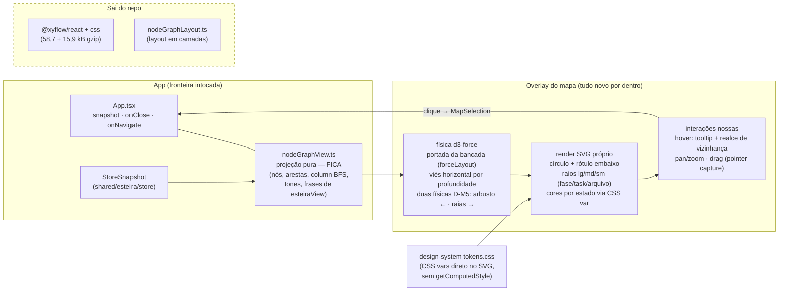

# Arquitetura do mapa de grafos novo — 012 Esteira 4.0

> Fase **Design** do item `wi-esteira4-mapa-grafos` · plano
> `pln-esteira4-forma-e-leitura` · discovery `dsc-15a7e7f5-fbb` · repo
> `donel-dev`. Produzido em 12/08/2026, ANTES de Implementar (F11).
>
> Este diagrama desenha COMO o motor ratificado (**A — d3-force + SVG
> próprio**, ver `mapa-grafos-escolha.md`) substitui a vista reprovada
> (F25, `NodeGraphOverlay.tsx`/React Flow) dentro do app. A **forma** já
> está fixada pelo dono (D-M1..D-M8, em
> `.esteira/design/wi-esteira4-mapa-grafos-prototipo/decisoes-forma-do-mapa.md`
> na branch `design/wi-esteira4-mapa-grafos-prototipo`) — nada aqui a
> redecide.

## O corte: a troca é interna ao overlay

A fronteira com o resto do app **não muda**. `App.tsx` continua montando o
overlay com as mesmas três props — `snapshot: StoreSnapshot | null`,
`onClose`, `onNavigate(target: MapSelection)` — e a projeção
`nodeGraphView.ts` (pura, 24 testes) continua sendo a única fonte de nós,
arestas, tons e frases de estado. O que morre e o que nasce fica todo
DENTRO de `src/renderer/src/DevMode/`.

## O que fica, o que entra, o que sai

| Destino | Peça | Por quê |
|---|---|---|
| **Fica** | `nodeGraphView.ts` (+24 testes) | Projeção pura do `StoreSnapshot` — já entrega nós/arestas/`column` (BFS)/`tone`; a regra "nenhuma frase de estado nasce no componente" segue valendo. |
| **Fica** | `MapSelection` / `onNavigate` | O grafo não inventa segundo modelo de navegação (decisão herdada da vista atual, reafirmada em D-M4). |
| **Entra** | `d3-force` 3.0.0 (5,6 kB gzip) | Dependência nova mínima — só a simulação; render, hover, pan/zoom e drag são nossos (custo aceito na escolha). |
| **Entra** | Física da bancada (`prototypes/mapa-grafos/src/forceLayout.ts`) | Viés horizontal por profundidade é a forma fixada (D-M1); portar para `DevMode/`, adaptando a entrada (ver divergências abaixo). |
| **Entra** | Componente SVG novo (substitui o corpo de `NodeGraphOverlay.tsx`) | Círculos + rótulo embaixo + satélites (D-M3), cores por estado (D-M2) lendo os MESMOS tokens (`TONE_VAR` já mapeia tone→CSS var — SVG lê CSS var nativamente, sem o `themeColors.ts` da bancada, que era gambiarra p/ WebGL). |
| **Sai** | `@xyflow/react` + css | Consumidores únicos no repo são `NodeGraphOverlay.tsx` e `nodeGraphLayout.ts` (verificado por grep em 12/08) — remove a dependência do `package.json`. |
| **Sai** | `nodeGraphLayout.ts` | Layout em camadas morre com o React Flow; posição agora nasce de simulação, nunca de coordenada calculada à mão (D-M1). |

## Divergências bancada → app que Implementar resolve (nomeadas, não escondidas)

1. **Fonte da profundidade**: a bancada calcula `computeDepth` sobre o
   modelo neutro do adapter; o app já tem `column` (BFS) no
   `nodeGraphView.ts`. Reusar `column` como profundidade da física e NÃO
   portar o `computeDepth` — um cálculo de profundidade só, no módulo que
   já tem teste. O `adapter.ts` da bancada (esteira.grafo → neutro) não
   entra nesta issue: a tela real come `StoreSnapshot`.
2. **Estados**: na bancada vinham do dataset; no app vêm do `tone` que a
   projeção já emite. O mapeamento D-M2 (concluído/rodando/esperando/
   travado/não-começou) precisa conferir se os tons atuais (`muted`,
   `accent`, `ok`, `warn`, `error`, `lock`) cobrem os cinco estados — a
   conferência é da spec/Implementar, o diagrama só fixa que a fonte é a
   projeção, nunca o componente.
3. **Avisos herdados da bancada** (registrados na escolha, seção 3):
   simulação órfã sob StrictMode (criar dentro do effect ou parar a
   descartada); `setPointerCapture` no drag (soltar fora do canvas hoje
   deixa a simulação quente); teste classes×CSS importando classes reais e
   assertando que a regra pinta (`fill`).
4. **D-M5/D-M6/D-M8 (arbusto, becos, laços)** dependem de dado que o
   `StoreSnapshot` pode ainda não carregar (spikes ligados ao Discovery,
   marca de beco morto, laço fix↔validar) — a expectativa de contrato está
   registrada no fim de `decisoes-forma-do-mapa.md`. O componente desenha o
   que a projeção entregar; o que faltar no dado vira nota da Implementar,
   não invenção no render.
