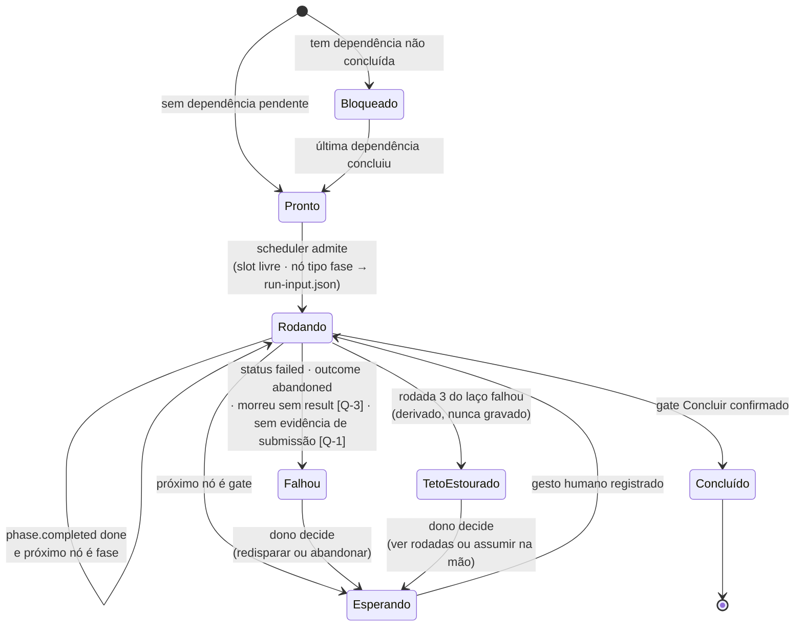

# Spec do motor de execução — a fila sobre os dois grafos — 012 Esteira 4.0

**Status:** 🟡 **PROPOSTA** (2026-08-09) — o texto normativo está escrito; as três
perguntas de alcance que a fase Design devolveu (`[Q-1]`…`[Q-3]`, seção 8) estão
**respondidas por recomendação, com o custo da alternativa**, e aguardam
ratificação do Alexandre — o mesmo rito que fechou as `[P-1]`…`[P-3]` do
catálogo. Até lá, as recomendações valem como proposta, não como requisito.
**Item:** `wi-esteira4-motor-spec` · plano `pln-esteira4-motor-de-execucao` ·
discovery `dsc-15a7e7f5-fbb`.
**Fonte de alcance:** `specs/012-esteira-4/catalogo.md` (🟢 decidida). Onde os dois
falarem do mesmo assunto, vence o catálogo; esta spec **consome** o grafo canônico
e a taxonomia dele, nunca os redecide.
**Fonte de forma:** os dois artefatos da fase Design
(`.esteira/design/wi-esteira4-motor-spec/` — mockup da fila e diagrama de
arquitetura). Forma → vence o design, sem abrandar; alcance ou comportamento →
vence esta spec, e a divergência vira nota, não silêncio.

> **Legenda de proveniência:** `[D-n]` decisão do dono, fechada ao vivo no
> Discovery de 07/08 · `[P-n]` alcance ratificado pelo dono em 08/08 (catálogo,
> seção 7) · `[F]` resolução de forma vinda da fase Design de 09/08 deste item ·
> `[Q-n]` pergunta de alcance devolvida pelo Design **deste** item, respondida por
> recomendação na seção 8, **a ratificar** · `[E]` evidência medida em
> disco/código, com caminho.

---

## Problema

O catálogo escreveu o grafo e nomeou as paradas. Falta quem ande: **o motor** — o
componente do app que olha o `esteira.grafo` de um plano, decide qual card pode
correr, abre worktree e sessão headless para cada fase 0% humana, para onde o
grafo manda parar, e sabe **quando desistir e chamar o dono**. Esta spec fixa a
máquina de estados desse motor. Ela é o molde das sete issues do plano — cada
issue implementa um pedaço do que está aqui; nada de código nasce neste item.

---

## 1. Os dois grafos, e o que o motor percorre `[F]`

O motor percorre **dois grafos em níveis diferentes**, e confundi-los é o defeito
que esta spec existe para impedir:

| Grafo | Nó | Aresta | Onde vive | O que responde |
|---|---|---|---|---|
| **Canônico** (catálogo, seção 1) | fase/gate/artefato | caminho do ciclo | código, fixo | *qual o próximo passo deste card?* |
| **De execução** (`esteira.grafo`) | **card** | dependência entre cards | `.esteira/`, escrito pelo Plano `[D]` | *qual card pode andar agora?* |

O motor tem três partes, e **nenhuma guarda estado**:

- **Scheduler** — lê o `esteira.grafo` e o log de fatos; card sem dependência
  pendente é *pronto*; admite prontos até o teto de paralelismo (`[Q-2]`).
- **Cursor por card** — a posição do card no grafo canônico, **derivada** dos
  `phase.completed` do log. Não é campo: é a mesma derivação do `derivedStage`
  `[D-13]` da 010, agora dirigindo execução em vez de só tela.
- **Derivação** — rodada do laço (`[P-2]`), `needsDesign` (`[P-1]`, lido do nó do
  card no `esteira.grafo`), estado do card (seção 2). Tudo recontado do log a
  cada olhada; nada somado, nada persistido pelo motor.

**Regra normativa (herdada do catálogo, seção 2):** só nó de tipo `fase` gera
`run-input.json`. Gate gera espera, artefato gera fato, nota não gera nada. Um
motor que dispare qualquer outro tipo está errado — e o erro é do motor, não do
grafo.

**Por que sem estado:** reinício do app, disparo manual no meio da fila e run
complementado (`complements_run_id`) não podem somar nem perder nada. O único
lugar onde a verdade mora é o log de fatos (store + mirror `.esteira/`) — é a
decisão `[P-2]` aplicada ao motor inteiro, não só ao contador.

---

## 2. A máquina de estados de um card

Cada card da fila está em **exatamente um** destes oito estados. O estado nunca é
gravado: é **derivado** do log de fatos mais duas observações de processo
(seção 6). Toda transição é causada por um fato no log, por um gesto humano (que
vira fato), ou por uma observação de processo nomeada aqui.

### 2.1 As transições, uma a uma

| De → para | Causa observável | De onde se deriva |
|---|---|---|
| `[*]` → **Bloqueado** | o `esteira.grafo` declara dependência de card sem `phase.completed(concluir, done)` | grafo + log |
| **Bloqueado** → **Pronto** | a última dependência ganhou `phase.completed(concluir, done)` | log |
| **Pronto** → **Rodando** | o scheduler admite: há slot no teto (`[Q-2]`) e o cursor aponta nó tipo `fase` → o motor grava `run-input.json` e abre a sessão headless | ação do motor |
| **Rodando** → **Rodando** | `result.json` com `phase.completed` `outcome: done` e o próximo nó do canônico é `fase` — a fila emenda a fase seguinte sem gesto | log |
| **Rodando** → **Esperando** | o próximo nó do canônico é `gate` (Você valida o Design, Teste local, Concluir) — a fila para, a tela chama | log + grafo canônico |
| **Esperando** → **Rodando** | o gesto humano do gate virou fato (`gate.confirmed` / `human_review.recorded`) | log |
| **Rodando** → **Falhou** | qualquer um: `run.status: failed` · `phase.completed` `outcome: abandoned` · sessão morreu sem `result.json` (`[Q-3]`) · disparo sem evidência de submissão (`[Q-1]`) | log + observação de processo |
| **Falhou** → **Esperando** | Falhou é **parada humana**: a tela mostra o motivo e as duas saídas — *redisparar* (run novo da mesma fase) ou *abandonar o card*. A fila nunca redispara um `failed` sozinha | gesto humano |
| **Rodando** → **TetoEstourado** | derivado: `rodada == 3 && a 3ª falhou` (seção 5) | log, contagem `[P-2]` |
| **TetoEstourado** → **Esperando** | dono escolhe uma das duas saídas do catálogo (§5): ver as 3 rodadas, ou assumir na mão | gesto humano |
| **Rodando** → **Concluído** | o gate Concluir confirmado virou fato — e este é o fato que **libera os dependentes** no grafo de execução | log |

### 2.2 `inconclusive` — a fase que não fechou

`phase.completed` com `outcome: inconclusive` não é sucesso nem falha: é "parou
sem fechar" (tipicamente orçamento de contexto). Regra do motor:

- o motor redispara **a mesma fase uma vez**, em sessão nova, com
  `complements_run_id` apontando o run inconclusivo — é o mecanismo que o
  contrato já prevê para continuação `[E]` (catálogo, seção 3.4);
- o **segundo** `inconclusive` seguido da mesma fase leva o card a **Falhou**
  (parada humana). Duas sessões que não fecharam é sinal de item grande demais —
  e item que precisa de três sessões era dois itens; quem requebra é gente, não
  a fila.

A contagem de inconclusivos seguidos é, como tudo, **derivada do log**: runs da
mesma fase do mesmo item encadeados por `complements_run_id`.

---

## 3. Paralelismo — o que corre junto

- **Paraleliza**: cards sem dependência entre si no `esteira.grafo`, cada um em
  **worktree própria** `[D]`, cada fase 0% humana em sessão headless própria.
- O teto de worktrees/sessões simultâneas é o `[Q-2]` (seção 8). Card pronto com
  o teto cheio **permanece Pronto** — estado que já existe, visível na fila; não
  nasce estado novo "na fila de admissão".
- **Ordem de admissão** quando há mais prontos que slots: a **sequência de merge
  declarada pelo Plano** desempata — ela é a única ordem que o dono já declarou
  `[D]`, e admitir nela minimiza card concluído esperando merge. Sem posição na
  sequência (item que não mergeia, ex.: spike), ordem de declaração no grafo.

## 4. Serialização — o que nunca corre junto

- **Fila de merge**: um merge por vez, **na sequência declarada pelo Plano** `[D]`
  — a fila não reordena, nem para desviar de conflito. Conflito imprevisto: o
  agente decide **pela spec**, registra conflito e decisão como fato; quem revê é
  a Validar `[D]`.
- **Suíte + build + e2e**: roda **1× por plano**, depois do último merge da leva
  — cardinalidade por plano, não por card (catálogo, `[F-2]`). O motor só a
  dispara quando **todos** os cards da sequência de merge do plano concluíram o
  merge; cards fora da sequência não a seguram.

---

## 5. O laço `fix ↔ validar staging` visto pelo motor

O laço vive **dentro da Validar** e tem teto de **3 rodadas** (catálogo, seção 5
— fechado, não reabrir). O que cabe ao motor:

- **contar sem guardar** `[P-2]`: rodada = número de runs da fase Validar do item
  cuja verificação ficou `failed`, recontado do log a cada derivação;
- **mostrar antes de desistir**: o contador de rodadas é parte da forma — a tela
  exibe `rodada N de 3` derivada, no padrão do mockup (tela 02) `[F]`;
- **parar na terceira**: `rodada == 3 && falhou` → **TetoEstourado**. A tela
  mostra o último achado, a branch, e as duas saídas (tela 03 do mockup) `[F]`.
  Nenhuma quarta tentativa automática, nunca.

---

## 6. O contrato motor ↔ sessão headless

O motor **depende** de a sessão headless receber o próprio Enter — e o conserto
do envio é o **item solto do auto-start** deste mesmo plano, não esta spec. O que
esta spec fixa é a fronteira: **o que o motor exige da sessão para acreditar
nela**, seja quem for que conserte o envio.

1. **Iniciou = evidência de submissão, nunca retorno de write.** `injectCommand`
   retornar `true` não conta — foi exatamente o que produziu o settled falso sem
   toast (achado do Discovery, hipótese na fronteira do item do auto-start). O
   que conta como evidência é o `[Q-1]` (seção 8).
2. **Rodando ≠ vivo por fé.** O motor distingue "rodando ainda" de "morreu sem
   `result.json`" por observação de processo, não por fato — porque sessão morta
   não deixa fato. Como: `[Q-3]` (seção 8).
3. **Terminou = `result.json` no outbox.** A fase só conta como terminada com o
   `result.json` validado pelo contrato v1 — o mesmo gate `esteira:check` que as
   skills já atravessam `[E]`. Output no terminal não é evidência de término.

---

## 7. Requisitos de tela herdados da forma `[F]`

O mockup (`.esteira/design/wi-esteira4-motor-spec/mockup-fila-motor.html`) é a
forma; esta seção só pina o que nele é **comportamento**, para a Implementar das
issues não abrandar:

- **Nenhum passo automático pede clique** (critério de aceite do catálogo, §4).
  Botão na fila = parada humana, sempre. LED = fase rodando headless; linha âmbar
  com botão = gate; chip na trilha = artefato (o PR de staging **nunca** vira
  linha da fila).
- **Contador de rodadas visível** antes de a fila desistir, com a origem da
  derivação escrita (`derivada de N runs failed`).
- **Teto estourado mostra**: o último achado, a branch, e exatamente as duas
  saídas — ver as 3 rodadas, ou assumir na mão.
- A barra do plano mostra a ocupação do teto de paralelismo (`worktrees: 3/4`).

Divergência conhecida e mantida: o diagrama do Design desenha `/no-mistakes` como
nó de fase; pela ratificação `[P-3]` ele é passo interno da Implementar e **não
existe no grafo canônico**. Onde os artefatos do Design mostram o nó, vale o
catálogo — divergência já registrada lá (seção 7), não se re-registra aqui.

---

## 8. As três perguntas de alcance — respondidas por recomendação, a ratificar

A fase Design devolveu três perguntas **de propósito** (diagrama, seção 6), para
esta spec não herdar decisão tomada por acidente no desenho. As três seguem
abaixo com recomendação e custo da alternativa — o rito é o mesmo das
`[P-1]`…`[P-3]`: **valem como proposta até o Alexandre ratificar**, e a
ratificação (ou a correção) deve ser registrada aqui, com data, antes de as
issues que dependem delas implementarem.

### `[Q-1]` O que é "evidência de submissão" — 🟡 proposta

**Recomendação: output novo do processo no PTY após o envio do terminador,
dentro de um timeout curto (default 10 s).**

Submissão observável = depois que o motor envia o `\r`, o processo do CLI
**escreve qualquer coisa nova** no PTY (spinner, eco de turno, primeiro token).
É o sinal mais barato que não depende de parsing do REPL. Sem output novo dentro
do timeout → a fase **não iniciou**: card vai a Falhou com motivo
`sem-evidencia-de-submissao`, com toast — o oposto do settled silencioso de hoje.

**Custo das alternativas:** *eco do prompt* exige parsear a renderização do REPL
(frágil a cada versão do CLI); *fato declarado* (`result.json`) só chega no fim
da fase — detectaria o Enter perdido horas depois, que é exatamente o buraco
atual. O delta de output pode dar falso-positivo (o REPL redesenha sem ter
submetido), mas o falso-positivo é coberto pelo `[Q-3]`: sessão "rodando" que
não produz nada cai no limite de inatividade.

### `[Q-2]` Limite de paralelismo — 🟡 proposta

**Recomendação: teto configurável nas settings, default 4.**

Worktree + sessão headless custam disco, CPU e cota de sessão; ilimitado não é
opção. O default 4 é o que a forma já mostra (`worktrees: 3/4` no mockup) e
cabe numa máquina de desenvolvimento típica. Card pronto com teto cheio fica em
**Pronto** (seção 3) — visível, sem estado novo. Mudar o teto no meio de uma
leva vale na próxima admissão; o motor nunca mata sessão para "encaixar".

**Custo da alternativa** (teto fixo em código): a máquina do dono muda, o teto
não — e um teto errado para menos serializa a leva inteira sem o dono poder
agir; para mais, derruba a máquina. Configurável com default é o mesmo padrão
das demais settings do app.

### `[Q-3]` Rodando ainda × morreu sem `result.json` — 🟡 proposta

**Recomendação: dois sinais, ambos observados, nenhum gravado.**

1. **Processo morto**: o PTY é filho do app — exit é observável diretamente.
   Processo terminou sem `result.json` no outbox → **Falhou**, motivo
   `morreu-sem-result`, parada humana (seção 2.1). O motor **nunca** fabrica um
   `result.json` em nome da sessão morta — ausência declarada, não preenchida.
2. **Processo vivo mas mudo**: sem output novo no PTY por um limite de
   inatividade (default 15 min, configurável) → a fila marca o card como
   **possivelmente travado** e chama o dono, com duas saídas: *seguir
   esperando* ou *encerrar e assumir*. O motor **não mata a sessão sozinho** —
   fase longa legítima (suíte, e2e) é indistinguível de travamento por dentro,
   e matar trabalho vivo custa mais que esperar um gesto.

**Custo da alternativa** (heartbeat: a skill grava "estou viva" em disco):
cria um segundo canal de verdade fora do log de fatos, exige mudar as skills
todas, e um heartbeat atrasado por GC/IO viraria falso "morreu" — o mesmo modo
de falha que `[P-2]` extinguiu, reintroduzido pela porta dos fundos.

---

## 9. O que esta spec toca no código, e o que não toca

| Componente | Este item… | Por quê |
|---|---|---|
| Spec do motor (`specs/012-esteira-4/motor.md`) | **escreve** — este arquivo | é o entregável do item: spec, não código |
| Motor da fila (código) | **não escreve** — deságua nas sete issues do plano | cada issue implementa um pedaço desta máquina |
| `esteira.grafo` (formato) | **consome** — o molde é do plano irmão | o nó do card carrega `needsDesign` e a sequência de merge; o motor só lê |
| Contrato v1 (`esteira-result.schema.json`) | **não muda** | o motor deriva tudo de fatos que já existem; nenhum fato novo |
| Auto-start (`App.tsx` ~1289) | **não conserta** — item solto do plano | esta spec só fixa "iniciou = evidência de submissão" (seção 6) |
| Store + mirror `.esteira/` | **consome** | derivação lê o log; o motor não grava estado |
| Skills `esteira-*` | **não muda** | o contrato motor↔sessão é observação externa; a skill não coopera nem precisa saber |

---

## 10. Como esta spec se verifica

- **Agora (este item):** revisão do dono — este documento é o objeto do gate. A
  máquina de estados da seção 2 e as três respostas da seção 8 são o que ele
  precisa ver; a ratificação das `[Q-n]` fecha o status para 🟢.
- **Depois (nas issues):** a máquina de estados da seção 2 é pinável por teste de
  unidade puro — derivação de estado a partir de um log de fatos sintético, sem
  PTY, sem worktree. A issue do scheduler nasce com esse teste; uma transição
  fora da tabela 2.1 quebra com referência a esta spec no erro. O que não é
  pinável (o teto certo, o timeout certo) é o que a seção 8 levou ao dono.
